<div align="center">

# 🎯 Dartpéro

**Le compteur de fléchettes entre potes.**
X01, Tour du monde, Cricket et entraînement au checkout —
saisie fléchette par fléchette, suggestions de sortie, stats et historique.

**100 % local · hors ligne · sans compte · sans pub**

[**▶ Ouvrir l'app**](https://dartpero.web.app) · [Charte graphique](docs/CHARTE_GRAPHIQUE.md) · [Plan détaillé](docs/PROJECT_PLAN.md)

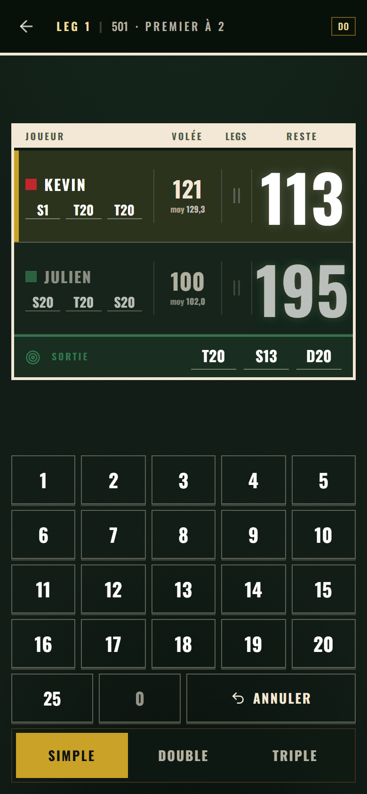

</div>

---

## Le contexte qui explique tout le reste

Le téléphone est **posé** — contre un mur, sur une table, sur une étagère — pendant que
plusieurs joueurs se relaient à la ligne de lancer. Un joueur tape les scores à 30 cm, **les
autres lisent le tableau à 2 ou 3 mètres**. Souvent dans un garage ou une cave mal éclairés,
**sans réseau**.

Tout le design en découle : des chiffres énormes en craie sur feutre, des cibles tactiles qui
ne descendent jamais sous 48 px, aucun écran de connexion, et une app qui marche avec l'avion
activé.

---

## Ce que ça fait

### Quatre modes de jeu

| | Mode | Ce que c'est |
| --- | ---- | ------------ |
| 🎯 | **X01** | 301 / 501 / 701, double in et double out, premier à N manches, sets en option. Le mode principal. |
| 🌍 | **Tour du monde** | Du 20 à la bulle, 21 cibles. On finit le tour de table, et le moins de fléchettes gagne. |
| ✖️ | **Cricket** | Sept cibles à fermer, variantes **standard** et **cut-throat** (où le plus petit score gagne). |
| 🎓 | **Entraînement** | Un reste tiré au sort entre 41 et 170, trois fléchettes pour le sortir. En solo. |

### Pendant la partie

- **Saisie fléchette par fléchette** — la grille 1-20 + 25, et une bascule S/D/T qui **retombe
  sur Simple après chaque fléchette**. Un multiplicateur resté armé sans qu'on le voie, c'est
  trois T20 comptés là où il y avait trois simples.
- **Suggestion de sortie** dès que le reste passe sous 170 — et « pas de finish » sur les
  *bogey numbers*, jamais une route bidon.
- **Annulation illimitée et fiable** : le bouton retire la fléchette qu'on vient de taper, ou
  la dernière volée enregistrée — même si elle avait gagné une manche.
- **L'écran ne s'éteint pas** (Wake Lock), le téléphone **vibre** à la validation, et une
  **voix française** annonce le score puis appelle le joueur suivant.
- **Mode paysage** automatique quand on couche le téléphone : lecture à gauche, pavé à droite.
- **Un nom pour chaque partie** — « Finale des potes », ou à défaut « Dimanche soir » : on la
  retrouve dans l'historique, en tête du résumé et sous le bandeau.

### Après la partie

- **La feuille de match** : joueurs en colonnes, statistiques en lignes, et le meneur de chaque
  ligne en laiton. Moyenne 3 fléchettes, first 9, % de doubles, 180 / 140+ / 100+, meilleure
  manche, plus haut checkout.
- **La carte des impacts** — où les fléchettes se sont réellement plantées, dessinée sur un
  plateau. L'échelle est propre à chaque joueur : on compare des **formes**, pas des volumes.
- **Statistiques de carrière** filtrables par période, historique filtrable par mode.
- **Export / import JSON** de toute la base — le seul moyen de changer de téléphone sans tout
  perdre, puisqu'il n'y a pas de serveur.

---

## Les écrans

<table>
<tr>
<td width="33%" align="center">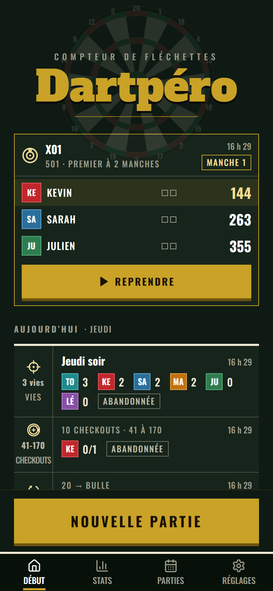<br><sub><b>L'accueil</b><br>La partie en cours se reprend d'un doigt</sub></td>
<td width="33%" align="center">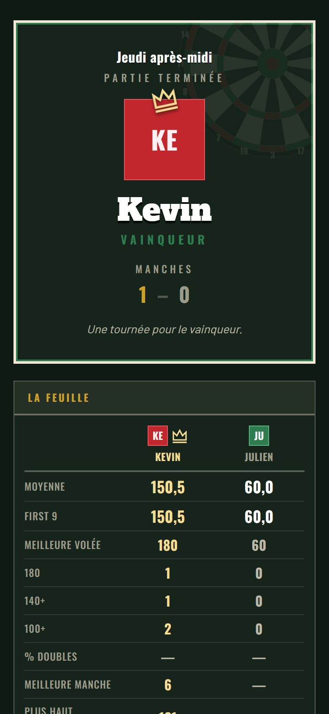<br><sub><b>Le résumé</b><br>La feuille transposée, meneur par ligne</sub></td>
<td width="33%" align="center">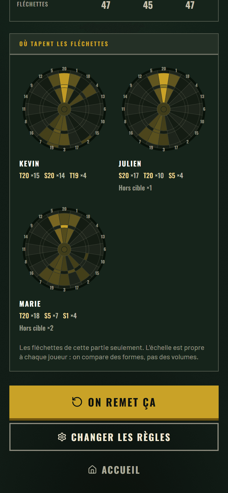<br><sub><b>Les impacts</b><br>Le plateau réduit à sa structure</sub></td>
</tr>
<tr>
<td align="center">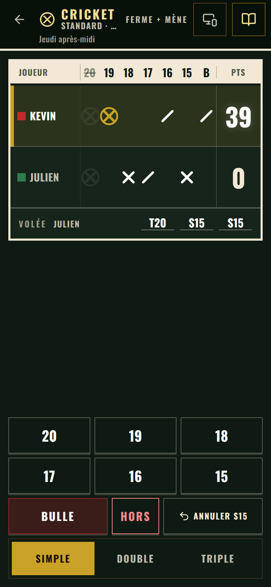<br><sub><b>Cricket</b><br>Sept cibles, marques et points</sub></td>
<td align="center">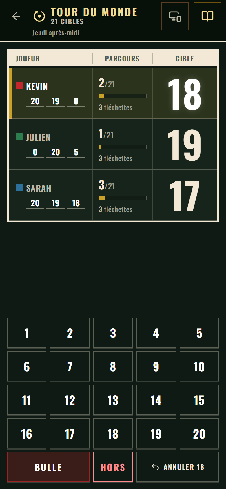<br><sub><b>Tour du monde</b><br>Départagé aux fléchettes</sub></td>
<td align="center">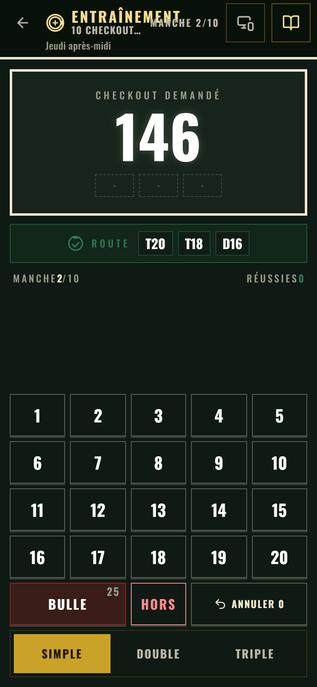<br><sub><b>Entraînement</b><br>Jamais un reste impossible</sub></td>
</tr>
<tr>
<td align="center">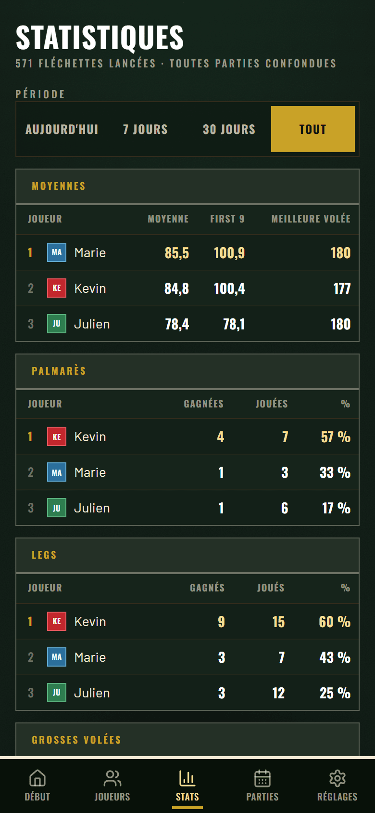<br><sub><b>Statistiques</b><br>Classées, filtrables par période</sub></td>
<td align="center">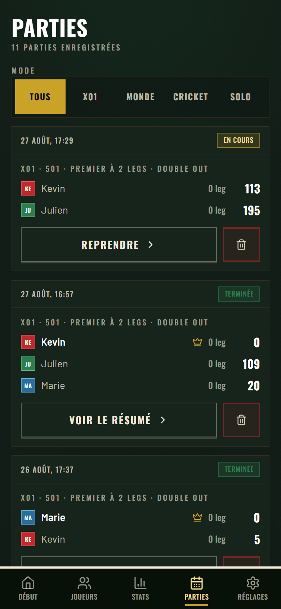<br><sub><b>Historique</b><br>Filtrable par mode</sub></td>
<td align="center">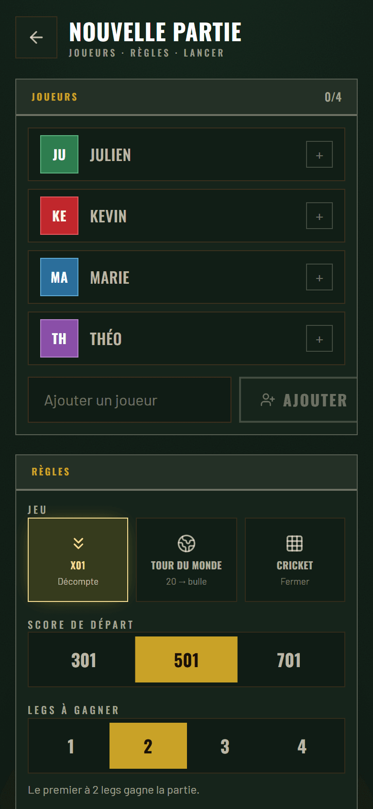<br><sub><b>Nouvelle partie</b><br>Joueurs, règles, lancer</sub></td>
</tr>
</table>

**Le téléphone couché** bascule en deux colonnes — ce qui lui manque, c'est la hauteur, pas la
largeur :

<div align="center">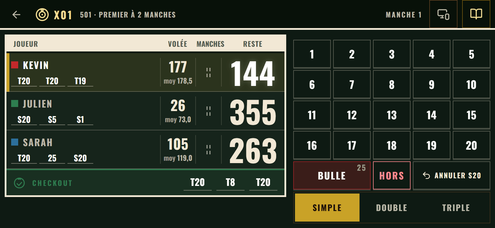</div>

**Le thème clair** est la *même* feuille de match — encre sur papier plutôt que craie sur
feutre. Le sombre reste le défaut : le cadrage, c'est un garage mal éclairé.

<table>
<tr>
<td width="50%" align="center">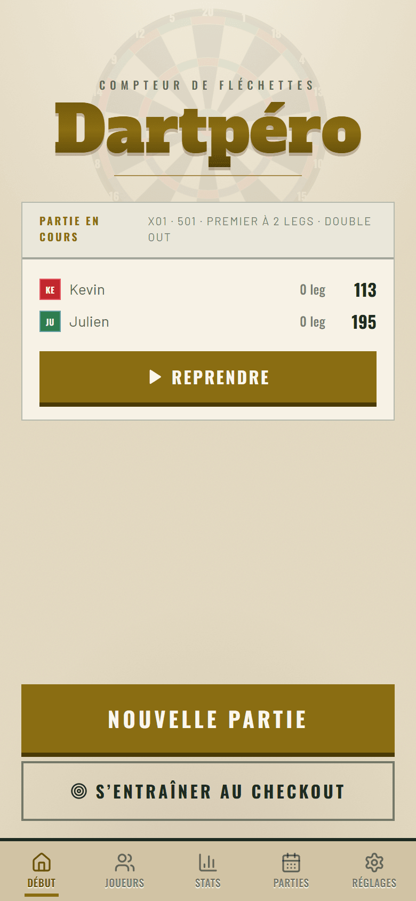</td>
<td width="50%" align="center">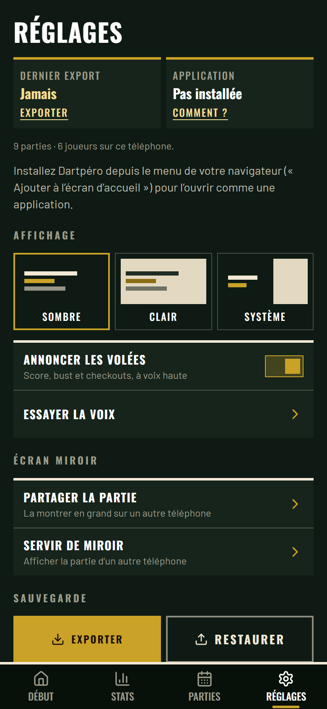</td>
</tr>
</table>

---

## Installer

Il n'y a rien à installer depuis un store : c'est une **PWA**.

| Appareil | Comment |
| -------- | ------- |
| **Android** | Ouvrir [dartpero.web.app](https://dartpero.web.app) dans Chrome → menu → *Ajouter à l'écran d'accueil*. |
| **iPhone** | Ouvrir dans **Safari** (et non Chrome, qui ne sait pas installer de PWA sur iOS) → Partager → *Sur l'écran d'accueil*. |

Une fois installée, elle fonctionne **entièrement hors ligne**. Les parties, les profils et les
statistiques vivent dans l'IndexedDB du téléphone — rien ne part sur un serveur, il n'y a pas
de compte à créer.

⚠️ **Corollaire assumé** : perdre le téléphone, c'est perdre l'historique. D'où l'export JSON
dans les Réglages, qui est le filet de sécurité.

---

## Développer

```bash
npm install
npm run dev          # http://localhost:5173
```

`localhost` **est** un contexte sécurisé : le Wake Lock, la vibration et le service worker y
fonctionnent déjà, sans avertissement de certificat.

Pour tester depuis un vrai téléphone sur le même WiFi :

```bash
npm run dev:mobile   # https://<IP-du-PC>:5173 — accepter le certificat auto-signé
```

| Commande | Ce qu'elle fait |
| -------- | --------------- |
| `npm test` | La suite Vitest — **689 tests** |
| `npm run test:watch` | La même, en continu |
| `npm run lint` | Biome (lint + format). **Jamais ESLint ni Prettier.** |
| `npm run typecheck` | `tsc --noEmit` |
| `npm run build` | Typecheck puis build de production |
| `npm run icons` | Régénère les icônes PWA depuis `scripts/icon.svg` |
| `npm run firebase:deploy` | Build + smoke test + déploiement sur Firebase Hosting |

**Stack** : React 19 · TypeScript 7 · Vite 8 · Tailwind CSS 4 · React Router 8 · TanStack Query ·
Dexie (IndexedDB) · Vitest + Testing Library · Biome · `vite-plugin-pwa`.

---

## L'architecture, en une image

Le cœur est en **architecture hexagonale** (ports & adapters). Les dépendances pointent
**toujours vers l'intérieur** :

```
   ui / infrastructure  ──►  application (ports + use cases)  ──►  domain
   React, Dexie,             ce que l'app sait faire,              les règles,
   Wake Lock, voix           et ce dont elle a besoin              pures et testables
```

- **`src/core/domain/`** — zéro import externe. Ni React, ni Dexie, ni API navigateur, **ni
  `Date.now()` ni `Math.random()`** : ils passent par les ports `Clock` et `IdGenerator`, ce qui
  rend les tests déterministes.
- **`src/core/application/`** — les ports (ce que l'UI peut demander, ce dont le cœur a besoin)
  et les use cases qui les implémentent.
- **`src/infrastructure/`** — les adapters : Dexie, Wake Lock, vibration, `localStorage`,
  synthèse vocale. Chacun a une doublure in-memory pour les tests.
- **`src/composition/container.ts`** — le **seul** point de câblage ports → adapters.

Deux garde-fous vérifient que ça tient : un `override` **Biome** sur `src/core/**` qui refuse
les imports externes dans l'éditeur, et un **test d'architecture** qui lit les imports réels de
`src/` et attrape ce que la liste de paquets bannis n'avait pas prévu.

### Le choix qui structure tout : le match est un journal

Une partie n'est pas un état qu'on modifie, c'est une **liste d'événements** ; ce qu'on affiche
en est la **projection**, rejouée à chaque fois.

```
MatchStarted { config, playerIds, startingPlayerIndex }
VisitRecorded { darts: [T20, T20, S20] }
VisitRecorded { darts: [S1, D20] }
…
```

Annuler, c'est donc `project(events.slice(0, -1))` — **rien d'autre**. Pas d'état à défaire à
la main, donc aucun bug de restauration de score, alors qu'on se trompe de saisie très souvent
en pleine partie. Deux conséquences volontaires :

- **les legs gagnés, les sets et la fin de partie ne sont jamais stockés**, ils se déduisent.
  Sinon annuler voudrait dire « retirer la dernière volée **et** les événements qu'elle a
  déclenchés » — exactement la classe de bug qu'on cherche à éliminer ;
- **`VisitRecorded` ne porte pas de `playerId`** : à qui est le tour se déduit de la projection,
  donc le journal ne peut pas être en désaccord avec les règles.

### Ajouter un mode de jeu

Chaque mode a son **propre** événement d'ouverture, ses règles et son état complets. Rien n'est
mis en facteur artificiellement : `domain/games/index.ts` ne fait qu'**aiguiller** sur le
discriminant `mode`, et TypeScript garantit qu'aucun cas n'est oublié.

Le prix a été mesuré trois fois (Tour du monde, entraînement, Cricket) et il ne bouge pas : un
dossier `games/<mode>/`, un événement d'ouverture, trois lignes dans chaque aiguillage, un
dossier de composants et un écran.

⚠️ **Le mode se lit sur le premier événement du journal**, jamais sur un champ `mode` : c'est ce
qui rend une partie enregistrée avant l'arrivée du deuxième mode rejouable **pour toujours**,
sans migration ni valeur par défaut à deviner.

```
src/
├─ core/
│  ├─ domain/          games/ (un dossier par mode) · value-objects/ · entities/
│  │                   events/ · services/ (transverses : checkout, bust, impacts)
│  └─ application/     ports/driving · ports/driven · use-cases/
├─ infrastructure/     dexie/ · device/ · memory/ · system/
├─ composition/        container.ts   ← seul point de câblage
└─ ui/                 composants/ · ecrans/ · hooks/ · theme.ts · labels.ts
tests/                 domain/ · use-cases/ · infrastructure/ · architecture/ · ui/
```

---

## Les règles, prises au sérieux

C'est là que la plupart des compteurs amateurs se trompent, donc chaque règle ci-dessous est
couverte par des tests.

- **Bust** — la volée entière est annulée et le score revient à sa valeur d'avant : reste
  `< 0` ; et, **quand le double out est actif**, reste `== 1` (impossible à finir sur un double)
  ou reste `== 0` sans que la **dernière** fléchette soit un double. L'écran propose la sortie
  libre par défaut ; le double out se coche à la création de partie.
- **Le triple bull n'existe pas** — `Dart.of('BULL', 'TRIPLE')` est refusé par le domaine. Le
  bullseye à 50 **compte comme un double** pour la sortie.
- **Les 7 bogey numbers** (169, 168, 166, 165, 163, 162, 159) affichent « pas de finish ». Ils
  ne sont **pas codés en dur** : ils tombent d'une recherche exhaustive, et un test vérifie que
  *tous* les restes de 2 à 170 ont une route correcte ou sont exactement l'un de ces sept.
- **Une volée *busted* marque 0 point mais ses fléchettes sont comptées** dans la moyenne.
- **Les moyennes de carrière se recalculent depuis les totaux bruts**, jamais en moyennant des
  moyennes — ce qui serait faux dès que les parties n'ont pas la même longueur, et elles n'en
  ont jamais.
- **Un tiret, jamais « 0 % », quand rien n'est terminé** : « 0 % » veut dire « il a tout
  perdu », « rien » veut dire « on ne sait pas encore ».

---

## Ce que l'usage a fait retirer

Deux fonctionnalités livrées puis **supprimées après des soirées réelles**, et c'est
volontairement documenté ici :

- **Le mode rapide** (saisir un total de volée 0-180 au lieu de trois fléchettes) n'a jamais
  servi. La saisie 3-taps tient très bien, et c'était elle la condition technique des stats de
  doubles. Parti avec son pavé, son port, son use case et ses tests.
- **Le « best of N »** ne voulait plus rien dire à trois ou quatre joueurs, où la partie peut
  durer plus de legs que le format n'en annonce. Remplacé par **« premier à N manches »**
  (« manche » à l'écran, *leg* dans le code), qui est d'ailleurs ce que le domaine stockait
  depuis le début.

---

## Licence & état

Projet **personnel**, pour jouer entre potes. Pas de licence publiée, pas de contribution
attendue — mais le code est lisible et les décisions sont écrites.

Il reste une chose que les 689 tests ne peuvent pas couvrir : **la validation sur vrai
matériel** — la lisibilité à 3 mètres dans un vrai garage, le confort des cibles au pouce
debout, la tenue du wake lock sur une partie entière, et un passage sur un vrai iPhone.

<div align="center"><sub>Fait pour un garage, une cible et quelques bières.</sub></div>
