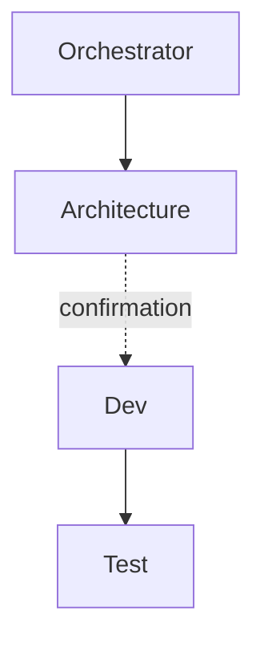

# Lot `<id-du-lot>` — graphe d'échanges

> Documentation de ce qui s'est **réellement** passé. Écrit par l'Orchestrator, pas par un
> sous-agent. N'invente rien.

## Légende

- Trait plein : phase exécutée, rapport écrit.
- Trait pointillé : confirmation utilisateur, gate, ou boucle de retour.

## Graphe

<!-- Remplacer par le déroulé réel : agents tentés, FAIL/PASS, confirmations, gates, boucles,
     bloqueurs, statut final. -->

## Rapports

- [00-orchestration.md](./00-orchestration.md)
- [01-architecture.md](./01-architecture.md)
- [02-dev-notes.md](./02-dev-notes.md)
- [03-plan-de-test.md](./03-plan-de-test.md)
- [04-revue-securite.md](./04-revue-securite.md)
- [05-revue.md](./05-revue.md)

## Statut final

<Terminé / Bloqué + raison.>
