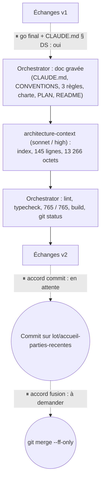
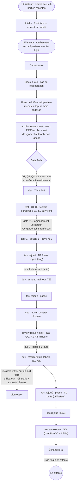

# Lot `accueil-parties-recentes` — graphe d'échanges

> Documentation de ce qui s'est **réellement** passé. Écrit par l'Orchestrator, pas par un
> sous-agent. N'invente rien.

## Version 2 — 2026-10-13, après le go final (avant le commit)

Le commit et la fusion attendent chacun un accord séparé. Le graphe de la Version 1 ci-dessous
reste valable jusqu'au go ; voici la suite.

**Ce qui change dans les tables de la Version 1** :
- **Skills** : `refresh-architecture` **n'a pas été invoquée** ; son brief, lu sur disque, a été
  passé directement à l'agent `architecture-context`.
- **Sous-agents** : ajouter `architecture-context` (sonnet / high, 1 lancement).
- **Règles** : `glossary.md`, `frontend-react.md` et `biome.md` sont **modifiées** par le lot.
- **Commandes** (Orchestrator) : `git log` du brief, mesure de l'index (`Measure-Object`,
  `Get-Item`), lint, typecheck, test, build et `git status` avant le commit.

## Version 1 — 2026-10-13, avant le go final

La gravure de la documentation, la régénération de l'index, le commit et la fusion n'ont pas
encore eu lieu.

## Légende

- Trait plein : phase exécutée, rapport écrit.
- Trait pointillé : confirmation utilisateur, gate, ou boucle de retour.

## Graphe

**Boucles : 3 tours sur 5.**
- Tour 1 : Test → Dev, boucle 1. Bug C2, amendement C7, tests renforcés à la demande de
  l'utilisateur.
- Tour 2 : Test → Dev, boucle 1. Bug N1, introduit par la correction de C2.
- Tour 3 : Revue → Dev, boucle 5. R1 à R5.

Aucun retour vers Archi.

## Agents, skills, règles et commandes utilisés

> Relevé vérifié dans la session (appels `Skill`, `Agent` et `subagent_type`, shell).

**Skills** (`.claude/skills/`)

| Skill | Déclenchée par | Usage |
|---|---|---|
| `intake` | Utilisateur (`/intake accueil-parties-recentes`) | Cadrage : `docs/request/accueil-parties-recentes.md` |
| `orchestrate` | Utilisateur (`/orchestrate accueil-parties-recentes high`) | Pilotage du lot |

`refresh-architecture` : pas encore appliquée (l'index était à jour au démarrage). Elle est
prévue après la gravure de `CLAUDE.md`.

**Sous-agents** (`.claude/agents/`)

| Agent | Modèle / effort | Lancements | Pour quoi |
|---|---|---|---|
| `archi-scout` | sonnet / low | 1 | Architecture : PASS |
| `archi-designer` | — | 0 | Scout en PASS |
| `archi-authority` | — | 0 | Scout en PASS ; aucune surface gravée |
| `dev` | sonnet / medium | 4 | Implémentation ; tours 1, 2, 3 |
| `test` | sonnet / high | 4 | Plan de test ; rejeux après les tours 1, 2, 3 |
| `sec` | sonnet / high | 2 | Revue sécurité ; rejeu après le tour 3 |
| `review` | opus / max | 2 | Revue (NO-GO) ; rejeu après le tour 3 (GO) |

⚠️ `test`, `sec` et `review` n'avaient que Read / Grep / Glob : les commandes, les
contre-épreuves et les `git show` ont été lancés par l'Orchestrator. Le modèle par défaut a été
gardé partout : aucune surface gravée, donc pas de montée en gamme.

**Règles** (`.claude/rules/`)

| Règle | Rôle dans le lot |
|---|---|
| `frontend-react.md` | Appliquée : use cases seulement, tout le français dans `labels.ts` (R1), cibles de 48 px, icônes `aria-hidden`. À compléter en fin de lot |
| `typescript.md` | Appliquée : surface exportée du cœur en anglais (R3), `switch` exhaustifs |
| `testing.md` | Appliquée : fakes, bornes locales, préconditions de changement d'heure, `it.each(GAME_MODE_IDS)`, absence prouvable (contre-épreuves) |
| `theme-colors.md` | Appliquée : tokens seuls, pas de vert DartsOn |
| `biome.md` | **À modifier** en fin de lot : exclusions `.claude/skills` et `.agents`, et la leçon de l'incident `lint:fix` |
| `persistence.md` | Vérifiée sans objet : aucun format persisté ne bouge |
| `glossary.md` | À compléter en fin de lot |
| `response-policy.md` | Appliquée : le point ambigu de l'intake (partie en cours de plus de 7 jours) a été posé à l'utilisateur, pas tranché seul |
| `commit.md` | Appliquée : branche du lot, pas de commit sans accord, fichiers hors du lot repérés |
| `documentation-language.md` | Appliquée |
| `prospective.md` | Vérifiée : l'étude source n'est pas renommée sans demande |

**Commandes shell** (toutes par l'Orchestrator, sauf mention)

| Commande | Usage |
|---|---|
| `git status`, `git log -1 --format=%ct -- <sources>`, `git switch -c lot/accueil-parties-recentes`, copie + `Get-FileHash` | Mise en place, fraîcheur de l'index, snapshot de l'intake |
| `npm run lint`, `npm run typecheck`, `npm test`, `npm run build` (après chaque passe) | 744, 761, 763, 765 |
| `scratchpad/mutations.ps1` et `mutations2.ps1` (`npx vitest run` par mutation, restauration vérifiée par `Get-FileHash`) | Contre-épreuves M1, M2, M4, M7, S1, S2, N3, R5, T1 |
| `npm audit --omit=dev`, `git diff --stat -- package*.json`, recherche de rendu HTML brut et de réseau | Sécurité |
| `git show HEAD:…/ApercuPartie.tsx`, `git diff -- src/index.css` | Revue : texte des règles, delta CSS |
| `Get-ChildItem` des skills (dates), `git check-ignore`, `npx biome check src tests` | Incident `lint:fix` et V1 |
| `npm run lint:fix` (**par le Dev**, tour 3, sur tout le dépôt) | ⚠️ A réécrit 7 scripts du skill tiers `impeccable`, non suivis par git. Réinstallé par l'utilisateur |

## Rapports

- [request.md](./request.md)
- [00-orchestration.md](./00-orchestration.md)
- [01-architecture.md](./01-architecture.md)
- [02-dev-notes.md](./02-dev-notes.md)
- [03-plan-de-test.md](./03-plan-de-test.md)
- [04-revue-securite.md](./04-revue-securite.md)
- [05-revue.md](./05-revue.md)

## Statut final

Go final donné ; documentation gravée, index régénéré. En attente de l'accord de commit. Revue
en **GO**, 3 tours sur 5, 765 tests verts.
