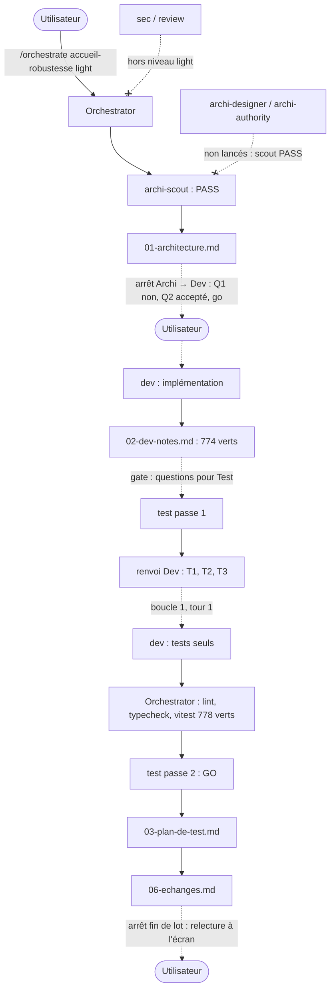

# Lot `accueil-robustesse` — graphe d'échanges

> Documentation de ce qui s'est **réellement** passé. Écrit par l'Orchestrator, pas par un
> sous-agent. N'invente rien.

## Origine

Avant le lot, dans la même session : critique `/impeccable critique` de
`src/ui/ecrans/AccueilEcran.tsx` (deux sous-agents `general-purpose` isolés : revue de design
et détecteur `impeccable detect` + captures `playwright-core`), sans écriture dans le dépôt.
L'utilisateur a retenu le volet « robustesse » et lancé `/orchestrate accueil-robustesse light`.

## Légende

- Trait plein : phase exécutée, rapport écrit.
- Trait pointillé : confirmation utilisateur, gate, ou boucle de retour.

## Graphe

## Agents, skills, règles et commandes utilisés

> Relevé vérifié dans la session (appels `Skill`, `Agent` et `subagent_type`, shell).

**Skills** (`.claude/skills/`)

| Skill | Déclenchée par | Usage |
|---|---|---|
| `orchestrate` | Utilisateur (`/orchestrate accueil-robustesse light`) | Pilotage du lot |
| `impeccable` | Utilisateur (`/impeccable critique …`), **avant** le lot | Critique qui a fixé le périmètre ; aucune écriture dans le dépôt |

**Sous-agents** (`.claude/agents/`)

| Agent | Modèle / effort | Lancements | Pour quoi |
|---|---|---|---|
| `archi-scout` | sonnet / low (frontmatter) | 1 | Architecture → PASS |
| `archi-designer` | — | 0 | Non nécessaire : scout en PASS |
| `archi-authority` | — | 0 | Non nécessaire : aucune surface gravée |
| `dev` | sonnet / medium, maxTurns 100 (frontmatter) | 2 | Implémentation ; boucle 1 (tests seuls) |
| `test` | sonnet / high (frontmatter) | 2 | Passe 1 (renvoi Dev), passe 2 (GO) — sans shell les deux fois |
| `sec`, `review` | — | 0 | Hors niveau `light` |

**Règles** (`.claude/rules/`)

| Règle | Rôle dans le lot |
|---|---|
| `frontend-react.md` | Appliquée : français dans `labels.ts`, icônes / flèches `aria-hidden`, cibles ≥ 48 px |
| `testing.md` | Appliquée : fakes par sous-classe, gardes d'absence falsifiables, contre-épreuves |
| `biome.md` | Appliquée : `lint:fix` limité à `src tests` (skills tiers non suivis présents) |
| `theme-colors.md` | Appliquée : aucune couleur nouvelle, `text-laiton` existant |
| `glossary.md` | Vérifiée : libellés conformes |
| `persistence.md` | Vérifiée sans objet : aucun format persisté |
| `commit.md` | Appliquée : branche `lot/accueil-robustesse`, accord avant commit |

**Commandes shell**

| Commande | Lancée par | Usage |
|---|---|---|
| `git status`, `git log`, `git switch -c lot/accueil-robustesse` | Orchestrator | Préconditions, fraîcheur de l'index, branche |
| `npx biome check --write src tests`, `npm run lint`, `npm run typecheck`, `npx vitest run` | Dev (deux passes) | Vérifications et contre-épreuves |
| `git diff --stat`, recherche d'accents cassés | Orchestrator | Périmètre du diff, encodage après restauration du Dev |
| `npm run lint`, `npm run typecheck`, `npx vitest run` | Orchestrator | Vérification après la boucle 1 (778 verts) |

## Rapports

- [00-orchestration.md](./00-orchestration.md)
- [01-architecture.md](./01-architecture.md)
- [02-dev-notes.md](./02-dev-notes.md)
- [03-plan-de-test.md](./03-plan-de-test.md)
- `04-revue-securite.md`, `05-revue.md` : hors niveau `light`, gabarits non remplis

## Statut final

Terminé côté pipeline (Test GO, 778 tests verts, 1 tour de boucle sur 5). En attente de la
relecture à l'écran par l'utilisateur, puis de son accord pour le commit et la fusion.
