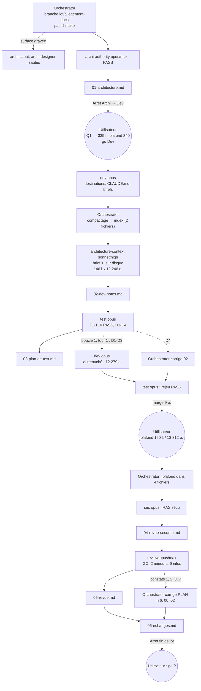

# Lot `allegement-docs` — graphe d'échanges

> Documentation de ce qui s'est **réellement** passé. Écrit par l'Orchestrator, pas par un
> sous-agent. N'invente rien.

## Légende

- Trait plein : phase exécutée, rapport écrit.
- Trait pointillé : confirmation utilisateur, gate, ou boucle de retour.

## Graphe

## Rapports

- [00-orchestration.md](./00-orchestration.md)
- [01-architecture.md](./01-architecture.md)
- [02-dev-notes.md](./02-dev-notes.md)
- [03-plan-de-test.md](./03-plan-de-test.md)
- [04-revue-securite.md](./04-revue-securite.md)
- [05-revue.md](./05-revue.md)

## Statut final

**Terminé côté phases** (Revue : GO), en attente du go utilisateur de fin de lot, puis du commit
sur `lot/allegement-docs` et de la fusion `--ff-only` dans `main` — chacun soumis à accord.
Boucles : 1 tour sur 5 (boucle 1).
