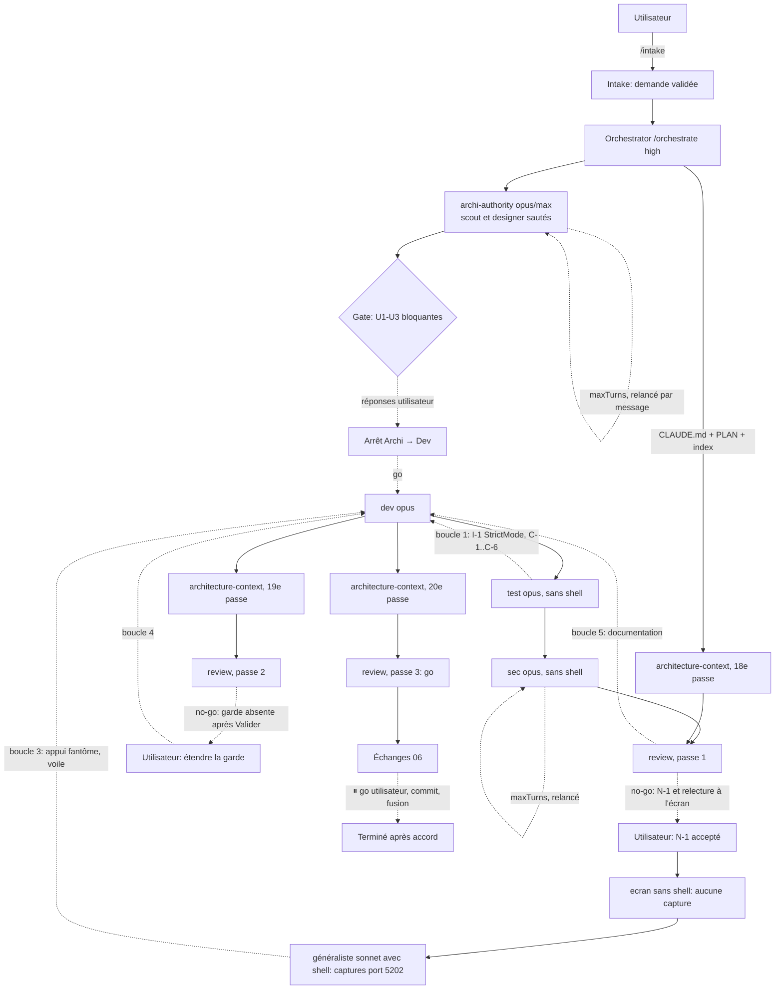

# Lot `annulation-volee` — graphe d'échanges

> Documentation de ce qui s'est **réellement** passé. Écrit par l'Orchestrator, pas par un
> sous-agent. N'invente rien. Lot mené **en parallèle** (worktree, port de capture 5202) avec les lots A
> (`vocabulaire-anglais`) et E (`phrases-victoire`) ; aucun rebase n'a encore eu lieu à la date de cette
> note (conflits à résoudre plus tard).

## Légende

- Trait plein : phase exécutée, rapport écrit.
- Trait pointillé : confirmation utilisateur, gate, ou boucle de retour.

## Graphe

Boucles de retour : 4 tours sur 5 (plafond global), sans remise à zéro — voir `00-orchestration.md`.

## Agents, skills, règles et commandes utilisés

> Relevé vérifié dans la session (appels `Skill`, `Agent` et `subagent_type`, shell).

**Skills** (`.claude/skills/`)

| Skill | Déclenchée par | Usage |
|---|---|---|
| `intake` | Utilisateur (`/intake annulation-volee`) | Demande validée `docs/request/annulation-volee.md` |
| `orchestrate` | Utilisateur (`/orchestrate annulation-volee high`) | Pilotage du lot |

Brief appliqué **sans invoquer la skill** : `refresh-architecture` → l'agent `architecture-context` a été
lancé directement (3 fois), avec le brief lu sur disque.

**Sous-agents** (`.claude/agents/` ; effort = celui du frontmatter, l'outil `Agent` ne le surcharge pas)

| Agent | Modèle / effort | Lancements | Pour quoi |
|---|---|---|---|
| `archi-scout` | sonnet / low | 0 | Sauté : surface gravée annoncée par l'intake |
| `archi-designer` | sonnet / high | 0 | Sauté : idem |
| `archi-authority` | opus / max | 1 (+1 relance par message : `maxTurns` atteint sans rapport) | Architecture |
| `dev` | opus (surcharge) / medium | 1 (+4 relances par message : boucles 1, 5, 3, 4) | Implémentation et corrections |
| `test` | opus (surcharge) / high | 1 | Plan de test, **sans shell** (les commandes ont été rejouées par l'Orchestrator) |
| `sec` | opus (surcharge) / high | 1 (+1 relance : `maxTurns` atteint sans rapport) | Sécurité, **sans shell** |
| `review` | opus / xhigh | 3 (+1 relance en 1re passe : `maxTurns`) | Revue (3 passes), **sans shell** |
| `ecran` | sonnet / medium | 1 | Relecture à l'écran : **aucune capture** (pas de shell) |
| `general-purpose` | sonnet | 2 | Captures et tests manuels dans Chrome sur le port 5202 (relecture, puis re-vérification des deux corrections) |
| `architecture-context` | sonnet / high | 3 | Index d'architecture (18e, 19e, 20e passes) |

**Règles** (`.claude/rules/`)

| Règle | Rôle dans le lot |
|---|---|
| `commit.md` | Appliquée : accord avant commit, branche du lot (commit non fait à cette date) |
| `documentation-language.md` | Appliquée : tous les fichiers du lot en français |
| `glossary.md` | Appliquée : « manche », « sortie », « bulle » à l'écran |
| `persistence.md` | Vérifiée sans objet : aucun format persisté ne bouge |
| `frontend-react.md` | **Modifiée** (`useConfirmationSortie` ajouté à la liste des hooks) ; appliquée |
| `theme-colors.md` | **Modifiée** (le jeton `voile` élargi à `BoiteConfirmation`, quatre entrées de garde) ; appliquée |
| `testing.md` | Appliquée : fakes, `gestes.ts`, contre-épreuves |
| `biome.md`, `typescript.md` | Appliquées |
| `response-policy.md` | Appliquée : questions produit posées à l'utilisateur, jamais tranchées par une phase |

**Commandes shell** (Orchestrator sauf mention)

| Commande | Lancée par | Usage |
|---|---|---|
| `npm run lint`, `npm run typecheck`, `npx vitest run`, `npm run build` | Dev (chaque tour) ; Orchestrator (rejeu après chaque tour) | Vérifications du lot ; 1534 → 1545 → 1551 → 1552 tests |
| `git status`, `git diff --stat`, `git diff -U0 -- MatchEvent.ts`, `git branch --show-current` | Orchestrator | Périmètre, format persisté |
| `npm audit --omit=dev` ; recherche de `REMPLIR` / `fetch(` dans `dist/` | Orchestrator | Pour `sec`, qui n'avait pas de shell : 0 vulnérabilité |
| `npx biome check src tests` | Orchestrator | Après les retouches de commentaires |
| `npm run build` + `vite preview --port 5202` + Chrome (`playwright-core`) | Agents généralistes | Relecture à l'écran |
| Création du dossier du lot, copie octet pour octet de `request.md` (empreintes comparées) | Orchestrator | Mise en place |

## Rapports

- [00-orchestration.md](./00-orchestration.md)
- [01-architecture.md](./01-architecture.md)
- [02-dev-notes.md](./02-dev-notes.md)
- [03-plan-de-test.md](./03-plan-de-test.md)
- [04-revue-securite.md](./04-revue-securite.md)
- [05-revue.md](./05-revue.md)

## Statut final

Terminé côté pipeline : Revue **go** (3e passe). **Reste, avec l'accord de l'utilisateur** : commit du lot
sur `lot/annulation-volee`, rebase sur `main` (conflits attendus avec A et E), fusion `--ff-only`.
Relecture sur vrai téléphone reportée (voir `05-revue.md` § Points non résolus).
