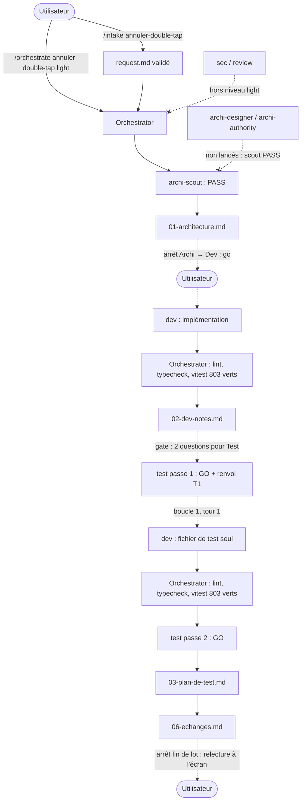

# Lot `annuler-double-tap` — graphe d'échanges

> Documentation de ce qui s'est **réellement** passé. Écrit par l'Orchestrator, pas par un
> sous-agent. N'invente rien.

## Origine

Lot 1 du découpage de l'étude `docs/prospective/2026-10-13-NEW-revision-charte-graphique.md`
(§ Constats hors charte : double tap sur « Annuler T20 »). Cadré par `/intake annuler-double-tap`
dans la même session : choix de l'utilisateur, courte pause plutôt que confirmation, 1 seconde.

## Légende

- Trait plein : phase exécutée, rapport écrit.
- Trait pointillé : confirmation utilisateur, gate, ou boucle de retour.

## Graphe

## Agents, skills, règles et commandes utilisés

> Relevé vérifié dans la session (appels `Skill`, `Agent` et `subagent_type`, shell).

**Skills** (`.claude/skills/`)

| Skill | Déclenchée par | Usage |
|---|---|---|
| `intake` | Utilisateur (`/intake annuler-double-tap`) | Cadrage, `docs/request/annuler-double-tap.md` |
| `orchestrate` | Utilisateur (`/orchestrate annuler-double-tap light`) | Pilotage du lot |

`refresh-architecture` non nécessaire : index jugé à jour.

**Sous-agents** (`.claude/agents/`)

| Agent | Modèle / effort | Lancements | Pour quoi |
|---|---|---|---|
| `archi-scout` | sonnet / low (frontmatter) | 1 | Architecture → PASS |
| `archi-designer` | — | 0 | Non nécessaire : scout en PASS |
| `archi-authority` | — | 0 | Non nécessaire : aucune surface gravée |
| `dev` | sonnet / medium, maxTurns 100 (frontmatter) | 2 | Implémentation ; boucle 1 (fichier de test seul) |
| `test` | sonnet / high (frontmatter) | 2 | Passe 1 (GO + renvoi T1), passe 2 (GO) — sans shell les deux fois |
| `sec`, `review` | — | 0 | Hors niveau `light` |

**Règles** (`.claude/rules/`)

| Règle | Rôle dans le lot |
|---|---|
| `testing.md` | Appliquée : fakes (`SettableClock`, `DepotSuspendu`), aucun mock ; `GAME_MODE_IDS` imposé (T1) ; gardes falsifiables par contre-épreuves |
| `frontend-react.md` | Appliquée : heure par `services.clock`, état du match local au hook de mode |
| `biome.md` | Appliquée : `lint:fix` limité à `src tests` |
| `typescript.md` | Appliquée : `Record<GameModeId, …>` dérivé de la liste fermée |
| `persistence.md` | Vérifiée sans objet : aucun format persisté |
| `theme-colors.md` | Vérifiée sans objet : aucune couleur, aucun composant modifié |
| `commit.md` | Appliquée : branche `lot/annuler-double-tap`, accord avant commit |

**Commandes shell**

| Commande | Lancée par | Usage |
|---|---|---|
| `git log -1 --format=%ct`, `git status`, `git switch -c lot/annuler-double-tap` | Orchestrator | Fraîcheur de l'index, préconditions, branche |
| Copie de `request.md` + comparaison d'empreintes | Orchestrator | Snapshot octet pour octet |
| `npx biome check --write src tests`, `npm run lint`, `npm run typecheck`, `npx vitest run` | Dev (deux passes) | Vérifications et contre-épreuves |
| `git status`, `git diff --stat`, recherche d'accents cassés et de mocks, `npm run lint`, `npm run typecheck`, `npx vitest run` | Orchestrator | Vérification après Dev puis après la boucle 1 (803 verts) |

## Rapports

- [request.md](./request.md)
- [00-orchestration.md](./00-orchestration.md)
- [01-architecture.md](./01-architecture.md)
- [02-dev-notes.md](./02-dev-notes.md)
- [03-plan-de-test.md](./03-plan-de-test.md)
- `04-revue-securite.md`, `05-revue.md` : hors niveau `light`, gabarits non remplis

## Statut final

Terminé côté pipeline (Test GO, 803 tests verts, 1 tour de boucle sur 5). En attente de la
relecture à l'écran par l'utilisateur, puis de son accord pour le commit et la fusion.
