# Lot `cartes-partie` — graphe d'échanges

> Documentation de ce qui s'est **réellement** passé. Écrit par l'Orchestrator, pas par un
> sous-agent. N'invente rien.

## Légende

- Trait plein : phase exécutée, rapport écrit.
- Trait pointillé : confirmation ou décision de l'utilisateur, gate, ou boucle de retour.

## Graphe

```mermaid
flowchart TD
  I["/intake cartes-partie<br/>4 choix, planche à jour validée, A-E"] -.->|/orchestrate cartes-partie light| O[Orchestrator]
  O --> B["Branche lot/cartes-partie<br/>depuis main e206bc9 ; index à jour"]
  B --> S1["archi-scout #1 : PASS<br/>+ §§ 10-11 de l'Orchestrator"]
  S1 -.->|arrêt Archi → Dev| U0{{"Utilisateur : mettre à jour les architectes<br/>(planche à l'identique, aucune décision produit)"}}
  U0 --> M["Briefs archi-* et orchestrate/SKILL.md mis à jour"]
  M --> S2["archi-scout #2 : PASS<br/>« Écarts : aucun », Q1-Q14"]
  S2 -.-> U1{{"Utilisateur : R1-R11, go"}}
  U1 --> D1["dev : 6 étapes → 1057 tests<br/>écarts et 9 points produit signalés"]
  D1 -.-> U2{{"Utilisateur (D1) : 3 corrections,<br/>le reste accepté"}}
  U2 --> D1b["dev (repris) → 1059 tests"]
  D1b --> T1["test #1 : PASS<br/>Q-A, Q-B, NB1-NB7"]
  T1 -.-> U3{{"Utilisateur : Q-A, Q-B"}}
  U3 -.->|boucle 1, tour 1| D2["dev (repris) → 1063 tests, captures"]
  D2 --> T2["test #2 : PASS<br/>4 questions"]
  T2 -.-> U4{{"Utilisateur : corbeille en icône seule,<br/>virgule, solo sans teinte, coupe tolérée,<br/>phrases validées"}}
  U4 -.->|boucle 1, tour 2| D3["dev (repris) → 1065 tests, capture v3"]
  D3 --> T3["test #3 : PASS"]
  T3 --> R["architecture-context : index régénéré<br/>153 lignes, 13 283 octets"]
  R --> E["06-echanges.md"]
  E -.->|arrêt de fin de lot| F{{"Go utilisateur,<br/>relecture à l'écran"}}
```

Chaque passage du Dev a été suivi de la relance par l'Orchestrator de lint, typecheck,
`npx vitest run`, build et d'un Grep d'encodage, tous verts. Deux tours de boucle sur cinq.
**Aucune décision produit n'a été prise par un agent ni par l'Orchestrator** après la mise à
jour des briefs : chaque point visible à l'écran a été posé à l'utilisateur.

## Constats et dettes hors lot

- **#21 de l'index (Moyenne)** : petit texte `text-laiton` préexistant (Accueil, retours des écrans
  de jeu), ≈ 3,5:1 en clair. Lot à part.
- **#24 (Basse)** : les résumés Cricket et Tour du monde trient encore `state.players` eux-mêmes,
  sans `rankPlayers` (`ResumeCricketEcran.tsx:58`, `ResumeTourDuMondeEcran.tsx:51`).
- **N1** : `accueilPartiesRecentes.test.tsx:1141`, `toHaveTextContent('')` sans effet (l'absence de
  texte reste gardée par deux autres assertions).
- **NB5** : cut-throat non couvert au niveau carte ; pas de test `summarize` → `rankPlayers` sur un
  vrai journal.
- **NB6** : la phrase « Terminée » du Cricket est inatteignable (fin toujours avec vainqueur).
- `JoueursEcran.tsx:140` garde son propre « Sûr ? » (autre écran).

## Agents, skills, règles et commandes utilisés

**Skills** (`.claude/skills/`)

| Skill | Déclenchée par | Usage |
|---|---|---|
| `intake` | Utilisateur (`/intake cartes-partie`) | Cadrage, planche à jour, `docs/request/cartes-partie.md` |
| `orchestrate` | Utilisateur (`/orchestrate cartes-partie light`) | Pilotage du lot ; **modifiée** pendant le lot à la demande de l'utilisateur |

`refresh-architecture` **n'a pas été invoquée** : son brief, lu sur disque, a été appliqué par
l'agent `architecture-context`. La planche a été écrite et publiée par l'Orchestrator pendant
l'intake (consignes de page chargées par `Artifact` en mode `quickstart`).

**Sous-agents** (`.claude/agents/`)

| Agent | Modèle / effort | Lancements | Pour quoi |
|---|---|---|---|
| `archi-scout` | sonnet / low | 2 | Tentative 1 (écartée : décisions produit), tentative 2 (retenue) |
| `archi-designer` | sonnet / high | 0 | Non lancé : scout en PASS |
| `archi-authority` | opus / max | 0 | Non lancé : aucune surface gravée |
| `dev` | sonnet / medium (maxTurns 100) | 1 (+3 reprises par message) | Lot ; corrections D1 ; boucles 1 et 2 |
| `test` | sonnet / high | 3 | Tentatives 1, 2, 3 (PASS) |
| `architecture-context` | sonnet / high | 1 | Index régénéré avant commit |
| `sec`, `review` | — | 0 | Hors niveau (`light`) |

**Règles** (`.claude/rules/`)

| Règle | Rôle dans le lot |
|---|---|
| `frontend-react.md` | Appliquée : composants dans `commun/`, libellés dans `labels.ts`, aucune règle de jeu dans l'UI (classement dans `application`), une cible ≥ 48 px |
| `theme-colors.md` | Appliquée : laiton unique, petit texte en `laiton-clair`, tokens seulement |
| `testing.md` | Appliquée : fakes, résumés écrits à la main, cut-throat des deux côtés, tests d'absence capables d'échouer (sauf N1) |
| `response-policy.md` | Appliquée : classement lu dans `CLAUDE.md` § Règles du jeu, aucune règle improvisée ; points produit posés à l'utilisateur |
| `biome.md` | Appliquée : `lint:fix` limité à `src tests` |
| `commit.md` | Appliquée : branche du lot, aucun commit avant accord |
| `prospective.md` | Appliquée : l'étude ne reçoit que les choix de l'intake |
| `documentation-language.md` | Appliquée : charte, CONVENTIONS, briefs, fichiers du lot en français |
| `persistence.md` | Vérifiée sans objet : aucun format persisté, `MatchSummary` intact |

**Commandes shell**

| Commande | Lancée par | Usage |
|---|---|---|
| `git switch -c lot/cartes-partie`, `git status`, `git log -1 --format=%ct` | Orchestrator | Branche, fraîcheur de l'index |
| `Copy-Item`, `Get-FileHash` | Orchestrator | Demande et snapshot octet pour octet ; copie du template |
| `npm run lint`, `npm run typecheck`, `npx vitest run`, `npm run build` | Orchestrator (×4) et Dev | 1057, 1059, 1063 puis 1065 tests |
| `npx biome check --write src tests` | Dev | Format |
| `playwright-core` sur un `vite` temporaire (port 5199), base importée par l'écran Réglages | Dev | Captures `scratchpad/cartes-partie/` (dont `parties-sur-clair-v3.png`) |
| `Get-Content` / `Get-Item` | Orchestrator, `architecture-context` | Mesure de l'index |

## Rapports

- [request.md](./request.md)
- [00-orchestration.md](./00-orchestration.md)
- [01-architecture.md](./01-architecture.md) (tentative 2 du scout, réponses R1-R11)
- [02-dev-notes.md](./02-dev-notes.md) (écarts et décisions D1)
- [03-plan-de-test.md](./03-plan-de-test.md) (tentatives 3, 2 puis 1)
- `04-revue-securite.md`, `05-revue.md` : hors niveau

## Statut final

**Terminé.** Phases du niveau `light` faites (Test PASS, tentative 3). Go de l'utilisateur à
l'arrêt de fin de lot (« ok deux commits puis fusionne ») : un commit `chore(workflow)` pour les
briefs d'architecte et la skill `orchestrate`, puis le commit du lot. Relecture à l'écran non
notée.
