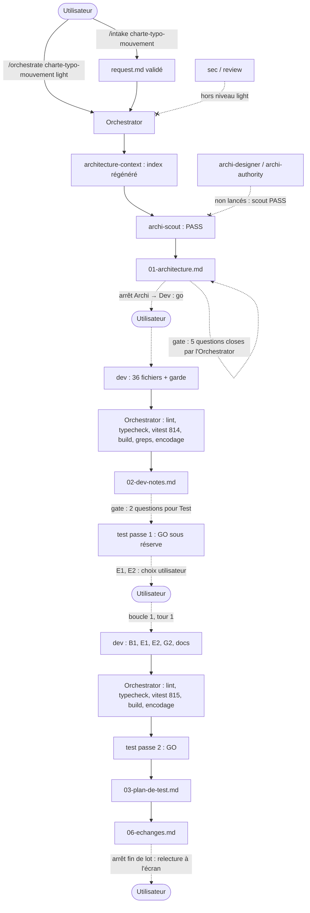

# Lot `charte-typo-mouvement` — graphe d'échanges

> Documentation de ce qui s'est **réellement** passé. Écrit par l'Orchestrator, pas par un
> sous-agent. N'invente rien.

## Origine

Lot 3 du découpage de l'étude `docs/prospective/2026-10-13-NEW-revision-charte-graphique.md`.
Cadré par `/intake charte-typo-mouvement` : quatre questions, puis relecture du brouillon contre
la maquette validée (`A-affiner.css`) à la demande de l'utilisateur. Trois choix initiaux ont
été remplacés par « ce que montrait la maquette » (enseigne en laiton plein, halos retirés
partout, souffle gardé sous le reste du lanceur), ce qui a ramené le lot de `high` à `light`.

## Légende

- Trait plein : phase exécutée, rapport écrit.
- Trait pointillé : confirmation utilisateur, gate, ou boucle de retour.

## Graphe

## Agents, skills, règles et commandes utilisés

> Relevé vérifié dans la session (appels `Skill`, `Agent` et `subagent_type`, shell).

**Skills** (`.claude/skills/`)

| Skill | Déclenchée par | Usage |
|---|---|---|
| `intake` | Utilisateur (`/intake charte-typo-mouvement`) | Cadrage, `docs/request/charte-typo-mouvement.md` |
| `orchestrate` | Utilisateur (`/orchestrate charte-typo-mouvement light`) | Pilotage du lot |

`refresh-architecture` **non invoquée** : son brief (`.claude/agents/architecture-context.md`) a
été relu sur disque et appliqué en lançant directement l'agent `architecture-context`.

**Sous-agents** (`.claude/agents/`)

| Agent | Modèle / effort | Lancements | Pour quoi |
|---|---|---|---|
| `architecture-context` | sonnet / high (frontmatter) | 1 | Index périmé régénéré (151 lignes, 13 279 octets) |
| `archi-scout` | sonnet / low (frontmatter) | 1 | Architecture → PASS |
| `archi-designer` | — | 0 | Non nécessaire : scout en PASS |
| `archi-authority` | — | 0 | Non nécessaire : aucune surface gravée modifiée |
| `dev` | sonnet / medium, maxTurns 100 (frontmatter) | 2 | Implémentation ; boucle 1 |
| `test` | sonnet / high (frontmatter) | 2 | Passe 1 (GO sous réserve), passe 2 (GO) — sans shell les deux fois |
| `sec`, `review` | — | 0 | Hors niveau `light` |

**Règles** (`.claude/rules/`)

| Règle | Rôle dans le lot |
|---|---|
| `theme-colors.md` | **Modifiée** : alphas interdits en `text-craie*/NN`, gardes citées, ombres portées permises |
| `frontend-react.md` | Appliquée : `prefers-reduced-motion` respecté, lisibilité à 2-3 m (plancher 0,75 rem) |
| `testing.md` | Appliquée : gardes falsifiables (planchers, chaînes synthétiques, contre-épreuves réelles) |
| `biome.md` | Appliquée : `lint:fix` limité à `src tests` |
| `persistence.md` | Vérifiée sans objet |
| `commit.md` | Appliquée : branche `lot/charte-typo-mouvement`, accord avant commit |

**Commandes shell**

| Commande | Lancée par | Usage |
|---|---|---|
| `git log -1 --format=%ct`, `git status`, `git switch -c lot/charte-typo-mouvement` | Orchestrator | Fraîcheur de l'index (périmé), préconditions, branche |
| Copie de `request.md` + comparaison d'empreintes | Orchestrator | Snapshot octet pour octet |
| Lecture de `Avatar.tsx`, `theme-colors.md` | Orchestrator | Clore Q2 de l'architecture |
| `npx biome check --write src tests`, `npm run lint`, `npm run typecheck`, `npx vitest run`, `npm run build`, greps, contre-épreuves | Dev (deux passes) | Vérifications |
| `git status`, `git diff --stat`, greps (`text-[…rem]`, `shadow-[0_0_`, `gradient`), relecture UTF-8 des fichiers modifiés, `npm run lint`, `npm run typecheck`, `npx vitest run`, `npm run build` | Orchestrator | Vérification après Dev puis après la boucle 1 (815 verts) ; deux alertes d'encodage de la console écartées comme faux positifs |

## Rapports

- [request.md](./request.md)
- [00-orchestration.md](./00-orchestration.md)
- [01-architecture.md](./01-architecture.md)
- [02-dev-notes.md](./02-dev-notes.md)
- [03-plan-de-test.md](./03-plan-de-test.md)
- `04-revue-securite.md`, `05-revue.md` : hors niveau `light`, gabarits non remplis

## Statut final

Terminé côté pipeline (Test GO, 815 tests verts, build OK, 1 tour de boucle sur 5). En attente de
la relecture à l'écran par l'utilisateur, puis de son accord pour le commit et la fusion.
