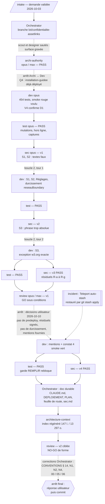

# Lot `confidentialite-assetlinks` — graphe d'échanges

> Documentation de ce qui s'est **réellement** passé. Écrit par l'Orchestrator, pas par un
> sous-agent. N'invente rien.

## Légende

- Trait plein : phase exécutée, rapport écrit.
- Trait pointillé : confirmation utilisateur, gate, ou boucle de retour.

## Graphe

Tours de boucle comptés : **2 / 5** (boucle 2, deux fois). Le passage Dev des mentions est une
demande de l'utilisateur, hors boucle. Test et Sécurité ont été rejoués **en parallèle** après
la boucle 2 tour 2 et après les mentions (changements indépendants et minimes).

## Rapports

- [request.md](./request.md) — demande validée par `/intake`
- [00-orchestration.md](./00-orchestration.md) — statut, blocages, journal, corrections
- [01-architecture.md](./01-architecture.md) — `archi-authority`, D1 à D6, V4
- [02-dev-notes.md](./02-dev-notes.md) — passage initial, boucle 2 (tours 1 et 2), mentions
- [03-plan-de-test.md](./03-plan-de-test.md) — passage initial et trois rejeux
- [04-revue-securite.md](./04-revue-securite.md) — versions 1 à 4, résiduels
- [05-revue.md](./05-revue.md) — versions 1 et 2

## Statut final

**Terminé** le 2026-10-10 : go de l'utilisateur (« oui commit » — formulations gardées, C5
accepté, éditeur et contact public confirmés). Commit sur `lot/confidentialite-assetlinks` ;
fusion `--ff-only` dans `main` sur accord séparé. Restent à l'utilisateur : déploiement, `curl.exe`
sur `/.well-known/assetlinks.json`, relecture sur appareil réel.
