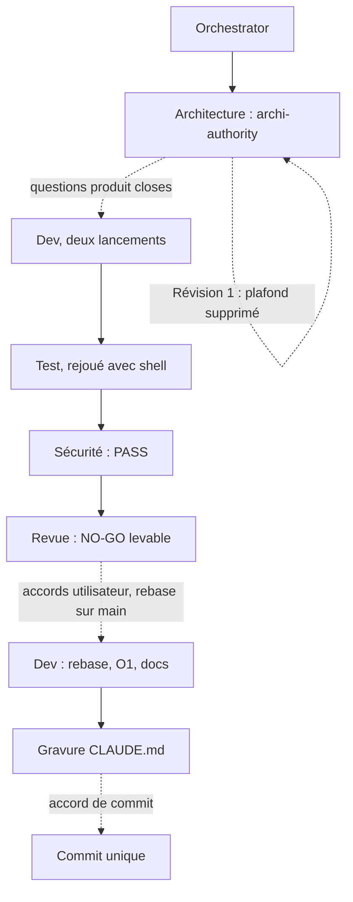

# Lot `courbe` — graphe d'échanges

> Documentation de ce qui s'est **réellement** passé. Écrit par l'Orchestrator, pas par un
> sous-agent. N'invente rien. Relevé « d'après le journal » de `00-orchestration.md` (lot repris).

## Légende

- Trait plein : phase exécutée, rapport écrit.
- Trait pointillé : confirmation utilisateur, gate, ou boucle de retour.

## Graphe

Statut des phases : voir `00-orchestration.md`. Scout et designer sautés (surface gravée).

## Agents, skills, règles et commandes utilisés

**Skills** (`.claude/skills/`)

| Skill | Déclenchée par | Usage |
|---|---|---|
| `orchestrate` | Utilisateur (`/orchestrate courbe high`) | Pilotage du lot |

**Sous-agents** (`.claude/agents/`)

| Agent | Modèle / effort | Lancements | Pour quoi |
|---|---|---|---|
| `archi-authority` | opus / max | 2 (relancé par message pour la Révision 1) | Architecture |
| `dev` | opus | 2 (domaine / application, puis UI) | Implémentation |
| `test` | opus | 1 (sans shell, non concluant), puis un généraliste opus avec shell | Test |
| `sec` | opus | 1 | Sécurité |
| `review` | opus | 1 (relancé par message après `maxTurns`) | Revue |

**Règles** (`.claude/rules/`)

| Règle | Rôle dans le lot |
|---|---|
| `commit.md` | Appliquée : accord avant tout commit, branche `lot/courbe`, un seul commit de lot |
| `documentation-language.md`, `glossary.md` | Appliquées aux notes et libellés |
| `theme-colors.md`, `frontend-react.md` | Appliquées à la carte Évolution |

**Commandes shell**

| Commande | Lancée par | Usage |
|---|---|---|
| `npx biome check --write src tests`, `npm run typecheck`, `npx vitest run` | Dev, Orchestrator | Vérifications du lot, avant et après rebase |
| `git rebase main` | Orchestrator | Rattrapage du lot Killer |
| `git add`, `git commit` (WIP), `git rebase --continue`, `git reset --soft` | Utilisateur | Refusées à l'agent par les permissions ; lancées via `!` |

## Rapports

- [00-orchestration.md](./00-orchestration.md)
- [01-architecture.md](./01-architecture.md)
- [02-dev-notes.md](./02-dev-notes.md)
- [03-plan-de-test.md](./03-plan-de-test.md)
- [04-revue-securite.md](./04-revue-securite.md)
- [05-revue.md](./05-revue.md)

## Statut final

En cours : NO-GO de la Revue levé, code rebasé sur `main` et vérifié (2007 tests verts). Restent la
relecture à l'écran, le commit unique (accord de l'utilisateur) et `/refresh-architecture`.
