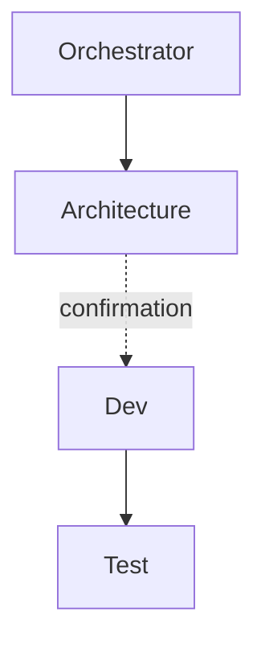

# Lot `ecran-miroir` — graphe d'échanges

> Documentation de ce qui s'est **réellement** passé. Écrit par l'Orchestrator, pas par un
> sous-agent. N'invente rien.

## Légende

- Trait plein : phase exécutée, rapport écrit.
- Trait pointillé : confirmation utilisateur, gate, ou boucle de retour.

## Graphe

<!-- Remplacer par le déroulé réel : agents tentés, FAIL/PASS, confirmations, gates, boucles,
     bloqueurs, statut final. -->

## Agents, skills, règles et commandes utilisés

> Relevé vérifié dans la session (appels `Skill`, `Agent` et `subagent_type`, shell) ; pour un
> lot repris, « d'après le journal » de `00-orchestration.md`.

**Skills** (`.claude/skills/`)

| Skill | Déclenchée par | Usage |
|---|---|---|
| `orchestrate` | Utilisateur (`/orchestrate ecran-miroir <niveau>`) | Pilotage du lot |

<!-- Un brief appliqué sans invoquer la skill (ex. refresh-architecture → agent
     architecture-context) se dit comme tel sous le tableau. -->

**Sous-agents** (`.claude/agents/`)

| Agent | Modèle / effort | Lancements | Pour quoi |
|---|---|---|---|
| `archi-scout` | sonnet / low | 1 | Architecture |

**Règles** (`.claude/rules/`)

Une règle ne s'invoque pas : elles sont chargées dans chaque session. Le tableau dit celles qui
ont **pesé** sur le lot.

| Règle | Rôle dans le lot (*modifiée*, *appliquée* ou *vérifiée sans objet*) |
|---|---|
| `commit.md` | Appliquée : accord avant commit, branche du lot |

**Commandes shell**

| Commande | Lancée par | Usage |
|---|---|---|
| `npm run lint`, `npm run typecheck`, `npm test` | Dev | Vérifications du lot |

## Rapports

- [00-orchestration.md](./00-orchestration.md)
- [01-architecture.md](./01-architecture.md)
- [02-dev-notes.md](./02-dev-notes.md)
- [03-plan-de-test.md](./03-plan-de-test.md)
- [04-revue-securite.md](./04-revue-securite.md)
- [05-revue.md](./05-revue.md)

## Statut final

<Terminé / Bloqué + raison.>
