# Lot `feuille-commune` — graphe d'échanges

> Documentation de ce qui s'est **réellement** passé. Écrit par l'Orchestrator, pas par un
> sous-agent. N'invente rien.

## Légende

- Trait plein : phase exécutée, rapport écrit.
- Trait pointillé : confirmation utilisateur, gate, ou boucle de retour.

## Graphe

```mermaid
flowchart TD
  P["Planche HTML (sous-agent general-purpose)<br/>artifact privé, 8 écrans + À trancher"] -.->|choix utilisateur| I["/intake feuille-commune<br/>docs/request/feuille-commune.md validé"]
  I -.->|utilisateur tape /orchestrate feuille-commune light| O[Orchestrator]
  O --> B["Branche lot/feuille-commune<br/>depuis main bcb4369"]
  B --> C["architecture-context<br/>index à jour → non régénéré"]
  C --> S1["archi-scout : PASS"]
  S1 --> A["01-architecture.md<br/>Q2 close, Q1/Q3/Q4 par mesure"]
  A -.->|arrêt Archi → Dev| U1{{"Utilisateur : garder « Pts ↓ » ;<br/>« ça correspond à la maquette ? »<br/>→ + §§ 10-19 Conformité à la planche, go"}}
  U1 --> D1["dev #1 : arrêté à 100 tours<br/>sans rapport"]
  D1 -.->|reprise par message, même agent| D1b["dev #1 (suite) : rapport<br/>933 tests, mesures, 52 captures"]
  D1b --> G1["Orchestrator : lint, typecheck,<br/>vitest, build, encodage → verts<br/>02-dev-notes.md, gate Dev"]
  G1 --> T1["test #1 : PASS<br/>constat 1 (bug mineur), 2-4 (tests)"]
  T1 -.->|boucle 1, tour 1| D2["dev #2 : libellés, 13 tests<br/>incident d'encodage réparé → 946 tests"]
  D2 --> G2["Orchestrator : contrôles verts,<br/>CricketEcran.tsx vérifié"]
  G2 --> T2["test #2 : PASS<br/>constats 1-4 clos"]
  T2 --> R["architecture-context : index régénéré<br/>(charte modifiée)"]
  R --> E["06-echanges.md"]
  E -.->|arrêt de fin de lot| F{{"Go utilisateur,<br/>relecture à l'écran, TQ1-TQ3"}}
```

Chaque passage du Dev a été suivi de la relance par l'Orchestrator de lint, typecheck,
`npx vitest run`, build, et d'un Grep d'encodage, tous verts. Un tour de boucle sur cinq.

## Agents, skills, règles et commandes utilisés

> Relevé vérifié dans la session (appels `Skill`, `Agent` et `subagent_type`, shell). La planche
> et le cadrage de l'intake ont eu lieu avant un résumé de contexte : ces lignes sont « d'après le
> résumé ».

**Skills** (`.claude/skills/`)

| Skill | Déclenchée par | Usage |
|---|---|---|
| `intake` | Utilisateur (`/intake feuille-commune`) | Cadrage, choix « À trancher », écriture de `docs/request/feuille-commune.md` |
| `orchestrate` | Utilisateur (`/orchestrate feuille-commune light`) | Pilotage du lot |

`refresh-architecture` **n'a pas été invoquée** : son brief, lu sur disque, a été passé
directement à l'agent `architecture-context`.

**Sous-agents** (`.claude/agents/`)

| Agent | Modèle / effort | Lancements | Pour quoi |
|---|---|---|---|
| `general-purpose` | — | 1 | Planche HTML du lot (avant l'intake, d'après le résumé) |
| `archi-scout` | sonnet / low | 1 | Architecture |
| `archi-designer` | sonnet / high | 0 | Non lancé : scout en PASS |
| `archi-authority` | opus / max | 0 | Non lancé : aucune surface gravée |
| `dev` | sonnet / medium (maxTurns 100) | 2 (+1 reprise) | Lot (arrêté à 100 tours, repris par message) ; boucle 1 |
| `test` | sonnet / high | 2 | Tentatives 1 et 2 (PASS) |
| `architecture-context` | sonnet / high | 1 | Index régénéré avant commit |
| `sec`, `review` | — | 0 | Hors niveau (`light`) |

**Règles** (`.claude/rules/`)

| Règle | Rôle dans le lot |
|---|---|
| `frontend-react.md` | Appliquée : briques dans `commun/`, libellés dans `labels.ts`, 48 px, paysage, relecture à l'écran |
| `theme-colors.md` | Appliquée : tokens seulement, `accent-mode`, aucun `text-craie*/NN` |
| `testing.md` | Appliquée : fakes, vraies fléchettes, annulation et rejeu à froid, tests qui peuvent échouer |
| `biome.md` | Appliquée : `lint:fix` limité à `src tests` |
| `commit.md` | Appliquée : branche du lot, aucun commit avant accord |
| `response-policy.md` | Appliquée : aucune règle de jeu touchée ; lecture de `lastRound`, `history` |
| `prospective.md` | Appliquée : l'étude ne reçoit que les choix de l'utilisateur, aucune décision gravée |
| `documentation-language.md` | Appliquée : charte et fichiers du lot en français |
| `persistence.md` | Vérifiée sans objet : aucun format persisté |

**Commandes shell**

| Commande | Lancée par | Usage |
|---|---|---|
| `git switch -c lot/feuille-commune`, `git status`, `git log -1 --format=%ct`, `git diff --stat` | Orchestrator | Branche, fraîcheur de l'index, état du travail |
| `Copy-Item`, `Get-FileHash` | Orchestrator | Demande et snapshot octet pour octet |
| `npm run lint`, `npm run typecheck`, `npx vitest run`, `npm run build` | Orchestrator (×2) et Dev | 933 puis 946 tests |
| `ReadAllBytes` (BOM, CRLF) sur `CricketEcran.tsx` | Orchestrator | Contrôle après l'incident d'encodage |
| `npx biome check --write src tests` | Dev | Format |
| `playwright-core` sur un `vite` temporaire (port 5198) | Dev | Mesures Chrome et 52 captures `scratchpad/feuille-commune/` |

## Rapports

- [request.md](./request.md)
- [00-orchestration.md](./00-orchestration.md)
- [01-architecture.md](./01-architecture.md) (§§ 10-19 ajoutés à l'arrêt Archi → Dev)
- [02-dev-notes.md](./02-dev-notes.md)
- [03-plan-de-test.md](./03-plan-de-test.md) (tentatives 2 puis 1)
- `04-revue-securite.md`, `05-revue.md` : hors niveau

## Statut final

**Terminé.** Phases du niveau `light` faites (Test PASS, tentative 2). Go de l'utilisateur à
l'arrêt de fin de lot (« Commit et fusionne ») : TQ1, TQ2, TQ3 acceptées ; le « S » des cases de
volée du Tour du monde reporté au lot 6b ; relecture sur téléphone non notée (captures fournies).
