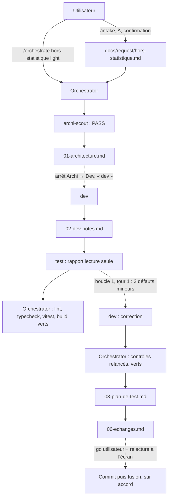

# Lot `hors-statistique` — graphe d'échanges

> Documentation de ce qui s'est **réellement** passé. Écrit par l'Orchestrator, pas par un
> sous-agent. N'invente rien.

## Légende

- Trait plein : phase exécutée, rapport écrit.
- Trait pointillé : confirmation utilisateur, gate, ou boucle de retour.

## Graphe

`archi-designer`, `archi-authority`, `sec` et `review` : non lancés (scout PASS ; niveau `light`).
Lot en cours : arrêt final en attente du go et de la relecture à l'écran.

## Agents, skills, règles et commandes utilisés

> Relevé vérifié dans la session (appels `Skill`, `Agent` et `subagent_type`, shell).

**Skills** (`.claude/skills/`)

| Skill | Déclenchée par | Usage |
|---|---|---|
| `intake` | Utilisateur (`/intake hors-statistique`) | Cadrage de la demande (même session) |
| `orchestrate` | Utilisateur (`/orchestrate hors-statistique light`) | Pilotage du lot |

**Sous-agents** (`.claude/agents/`)

| Agent | Modèle / effort | Lancements | Pour quoi |
|---|---|---|---|
| `archi-scout` | sonnet / low (frontmatter) | 1 | Architecture : PASS |
| `archi-designer` | — | 0 | Scout PASS |
| `archi-authority` | — | 0 | Scout PASS, aucune surface gravée |
| `dev` | sonnet / medium (frontmatter) | 2 | Implémentation ; correction de boucle 1 |
| `test` | sonnet / high (frontmatter) | 1 | Plan de test, lecture seule (aucune commande exécutée par lui) |
| `sec`, `review` | — | 0 | Hors niveau (`light`) |

**Règles** (`.claude/rules/`)

| Règle | Rôle dans le lot |
|---|---|
| `theme-colors.md` | *Modifiée* (section `rouge-touche`) et appliquée (jeton général, paire de rôle, contraste) |
| `frontend-react.md`, `testing.md`, `typescript.md` | Appliquées par Dev |
| `glossary.md` | Appliquée (« hors cible », « partie ») |
| `documentation-language.md` | Appliquée (docs en français) |
| `commit.md` | Appliquée : accord avant commit, branche `lot/hors-statistique` |
| `persistence.md` | Vérifiée sans objet (aucun format persisté) |

**Commandes shell**

| Commande | Lancée par | Usage |
|---|---|---|
| `npm run lint`, `npm run typecheck`, `npx vitest run` | Dev (2 passes) ; Orchestrator (après Dev, puis après correction) | Vérifications du lot |
| `npm run build` | Orchestrator (2 fois) | Build + PWA |
| `git status`, `git diff --stat`, `git branch`, `git log -1 --format=%ct` | Orchestrator | Branche, fraîcheur de l'index, périmètre du diff |
| `Copy-Item` + `Get-FileHash` | Orchestrator | Snapshot `request.md` octet pour octet |

## Rapports

- [00-orchestration.md](./00-orchestration.md)
- [01-architecture.md](./01-architecture.md)
- [02-dev-notes.md](./02-dev-notes.md)
- [03-plan-de-test.md](./03-plan-de-test.md)
- 04-revue-securite.md, 05-revue.md : hors niveau

## Statut final

Phases Architecture, Dev, Test et Échanges faites. **En attente** : go de l'utilisateur,
relecture à l'écran (rendu modifié), puis commit sur `lot/hors-statistique` sur accord.
