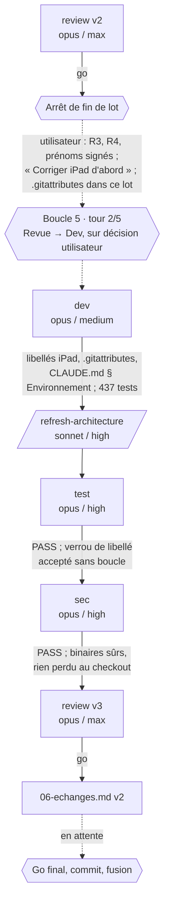

# Lot `installation-guidee` — graphe d'échanges

> Ce document retrace ce qui s'est **réellement** passé. Il est écrit par l'Orchestrator, pas
> par un sous-agent, et n'invente rien. La version la plus récente est en tête ; l'historique
> est conservé dessous.

## Légende

- **Trait plein** : la phase a été exécutée et son rapport écrit.
- **Trait pointillé** : confirmation de l'utilisateur, gate, ou boucle de retour.
- Entre crochets : modèle / effort réellement lancés.

## Version 2 — après le tour 2 (décision de l'utilisateur à l'arrêt de fin de lot)

**Compteurs** : 2 tours de boucle sur 5 (boucle 5 : 2/2, plafond atteint). Aucun FAIL
d'architecture, aucune boucle vers Archi.

**Statut** : en attente du go final de l'utilisateur, puis commit sur `lot/installation-guidee`
et fusion `--ff-only` (deux accords distincts).

## Version 1 — fin des phases, avant l'arrêt de fin de lot

```mermaid
flowchart TD
  U([Utilisateur]) -.->|/intake installation-guidee<br/>4 réponses, confirmation explicite| I[Intake<br/>docs/request/installation-guidee.md]
  U -.->|/orchestrate installation-guidee high| O[Orchestrator]
  I --> O
  O -->|index à jour, branche lot/installation-guidee,<br/>request.md copié octet pour octet| S0{{Surface gravée n° 4<br/>service worker / manifeste}}
  S0 -.->|scout et designer non lancés| AA[archi-authority<br/>opus / max]
  AA -->|Architecture result: PASS| A1[01-architecture.md]
  A1 -.->|gate : Q2 close, Q1 / Q3 → fin de lot,<br/>Q4 → PLAN § 0, Q5 → Sécurité| G1{{Arrêt Archi → Dev}}
  G1 -.->|« go dev »| D1[dev<br/>opus / medium]
  D1 -->|437 tests, smoke, 3 mutations| D1N[02-dev-notes.md]
  D1N -.->|gate : 5 questions résolues| T1[test<br/>opus / high]
  T1 -->|Test result: PASS<br/>16 mutations, L1 vert à vide| T1N[03-plan-de-test.md]
  T1N -.->|gate : L1 acceptée sans boucle| S1[sec<br/>opus / high]
  S1 -->|Security result: PASS<br/>Q5 close| S1N[04-revue-securite.md]
  S1N -.->|gate : R3 / R4 à signer| R0[/refresh-architecture<br/>sonnet / high/]
  R0 --> RV1[review<br/>opus / max]
  RV1 -->|v1 : no-go<br/>n° 1 rules/frontend-react.md| B5{{Boucle 5 · tour 1/5<br/>Revue → Dev, automatique}}
  B5 -.->|n° 1 + n° 2 + n° 11 ;<br/>n° 12 corrigé par l'Orchestrator| D2[dev<br/>opus / medium]
  D2 -->|437 tests, M1 détectée| R1[/refresh-architecture<br/>sonnet / high/]
  R1 --> T2[test<br/>opus / high]
  T2 -->|PASS, L1 close| S2[sec<br/>opus / high]
  S2 -->|PASS ; résiduel « prénoms »| RV2[review<br/>opus / max]
  RV2 -->|v2 : go| E[06-echanges.md]
  E -.->|en attente| G2{{Arrêt de fin de lot<br/>go utilisateur}}
```

**Compteurs** : 1 tour de boucle sur 5 (boucle 5 : 1/2). Aucun FAIL d'architecture, aucune
boucle vers Archi.

## Rapports

- [request.md](./request.md) — intake validé
- [00-orchestration.md](./00-orchestration.md) — statut, journal, historique des corrections
- [01-architecture.md](./01-architecture.md) — `archi-authority`, PASS
- [02-dev-notes.md](./02-dev-notes.md) — Dev, puis § Boucle 5, tour 1
- [03-plan-de-test.md](./03-plan-de-test.md) — Test PASS, puis § Rejeu
- [04-revue-securite.md](./04-revue-securite.md) — Sécurité PASS, puis § Rejeu
- [05-revue.md](./05-revue.md) — v1 no-go, v2 go, v3 go

## Statut final

**En attente du go final de l'utilisateur** (v2). R3, R4 et prénoms signés ; libellés iPad et
`.gitattributes` livrés au tour 2. Restent : validation d'ensemble des libellés, relecture à
l'écran, puis commit et fusion.
