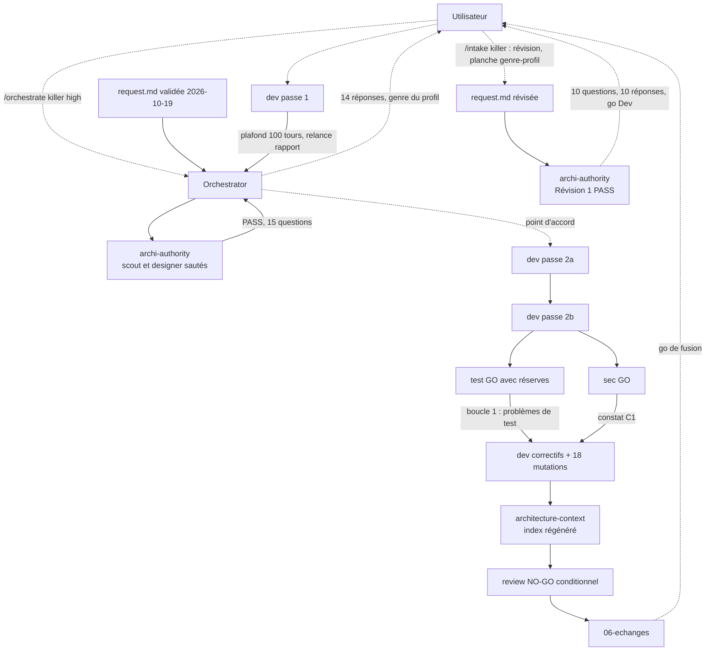

# Lot `killer` — graphe d'échanges

> Documentation de ce qui s'est **réellement** passé. Écrit par l'Orchestrator, pas par un
> sous-agent. N'invente rien. Lot mené **seul** dans le dépôt principal (pas de worktree), après les lots
> `volee-partielle`, `hors-statistique` et `phrases-victoire`, tous fusionnés.

## Légende

- Trait plein : phase exécutée, rapport écrit.
- Trait pointillé : confirmation utilisateur, gate, ou boucle de retour.

## Graphe

## Agents, skills, règles et commandes utilisés

> Relevé vérifié dans la session (appels `Skill`, `Agent` et `subagent_type`, shell).

**Skills** (`.claude/skills/`)

| Skill | Déclenchée par | Usage |
|---|---|---|
| `orchestrate` | Utilisateur (`/orchestrate killer high`) | Pilotage du lot (l'Orchestrator n'a pas pu l'invoquer lui-même : `disable-model-invocation`) |
| `intake` | Utilisateur (`/intake killer`) | **Révision** de la demande (genre du profil, « Éliminé par », réponses) |
| `artifact-design` | Orchestrator | Contrat de la planche `genre-profil` publiée |

`refresh-architecture` n'a pas été invoquée comme skill : le brief de l'agent `architecture-context` a été appliqué
en lançant l'agent directement.

**Sous-agents** (`.claude/agents/`)

| Agent | Modèle / effort | Lancements | Pour quoi |
|---|---|---|---|
| `archi-scout`, `archi-designer` | — | 0 | Sautés : surfaces gravées multiples |
| `archi-authority` | opus / max | 2 | Architecture (PASS, 15 questions produit) ; Révision 1 (genre, « Éliminé par », découpage en deux passes, PASS, 10 questions) |
| `dev` | opus (surcharge) / medium | 6 | Passe 1 (plafond de 100 tours atteint sans rapport, relancé pour le rapport), passe 2a, passe 2b, correctifs de Test + C1 + 18 mutations |
| `test` | opus (surcharge) / high | 1 | Plan de test, GO avec réserves, sans shell |
| `sec` | opus (surcharge) / high | 1 | Revue sécurité, GO, sans shell |
| `review` | opus / xhigh | 1 | Revue finale, NO-GO conditionnel, sans shell |
| `architecture-context` | sonnet / medium | 1 | Index d'architecture, 22e passe |

L'outil `Agent` ne surcharge que le modèle : les efforts sont ceux des frontmatters.

**Règles** (`.claude/rules/`)

| Règle | Rôle dans le lot |
|---|---|
| `persistence.md` | **Modifiée** : champ facultatif de profil sans `db.version`, donnée par joueur dans l'ouverture hors config, import qui projette tous les modes |
| `glossary.md` | **Modifiée** : genre, Killer, vie, killer (statut), éliminé |
| `frontend-react.md` | **Modifiée** : cinq hooks de mode |
| `theme-colors.md` | **Modifiée** : `rouge-touche` sert `FeuilleKiller`, avec ses contrastes |
| `testing.md` | Appliquée : fakes, jamais de mocks ; préconditions ; `it.each(GAME_MODE_IDS)` |
| `commit.md` | Appliquée : branche `lot/killer`, accord avant commit et fusion |
| `prospective.md`, `typescript.md`, `biome.md`, `documentation-language.md`, `response-policy.md` | Vérifiées / appliquées (français, « non vérifié » dit) |

**Commandes shell**

| Commande | Lancée par | Usage |
|---|---|---|
| `git switch -c lot/killer`, `git status`, `git diff --stat`, `git log`, `git worktree list` | Orchestrator | Branche du lot, état de l'arbre, snapshot de la demande, fichiers de déploiement |
| `npm run lint`, `npm run typecheck`, `npx vitest run`, `npm run build` | `dev` et Orchestrator (après chaque passe) | 1691 (début) → 1846 → 1874 → 1912 → **1929 tests verts** |
| `npx biome check --write src tests` | `dev` | Format |
| Grep `Ã|Â|�`, Grep `KILLER-PASSE-2` | Orchestrator | Accents cassés (RAS, « BÂTONS » légitime) ; marqueurs de la passe 1 (10 relevés, 0 à la fin) |
| `npm audit --omit=dev` | Orchestrator | 0 vulnérabilité |
| `node verif.cjs` (playwright-core) | Orchestrator | Capture de la planche `genre-profil` |
| Mutations manuelles (Edit puis retour, hash comparés) | `dev` (4e type) | 19 mutations, 18 rouges, 1 équivalente |

## Incidents du lot

- `dev` (passe 1) a atteint son plafond de **100 tours sans rapport** (267 appels) ; l'arbre était vert, le rapport
  a été obtenu par relance. Le brief des passes suivantes imposait un rapport avant le plafond : plus d'incident.
- La réponse « suivre la planche (accord au féminin) » imposait un **genre de profil**, hors demande et hors
  planche : l'Orchestrator l'a remonté (changement de périmètre sur deux formats persistés et la politique) au
  lieu de le trancher ; l'utilisateur a révisé la demande, validé une planche dédiée.
- La garde `hexagonalBoundary` avait **deux trous** (liste en dur et comparaison de chaînes) : corrigés.
- Le snapshot `request.md` a été remplacé par la version révisée avec l'accord de l'utilisateur ; l'ancien est
  gardé.
- L'utilisateur a donné le go de fusion **avant** avoir signé les points ouverts de la Revue ; l'Orchestrator n'en a
  déduit aucune acceptation de risque.

## Rapports

- [00-orchestration.md](./00-orchestration.md)
- [request.md](./request.md), [request-2026-10-19.md](./request-2026-10-19.md)
- [01-architecture.md](./01-architecture.md)
- [02-dev-notes.md](./02-dev-notes.md)
- [03-plan-de-test.md](./03-plan-de-test.md)
- [04-revue-securite.md](./04-revue-securite.md)
- [05-revue.md](./05-revue.md)

## Statut final

**Terminé sur la branche, fusion sur le go de l'utilisateur.** Code et documentation prêts : lint, typecheck, build
propres, **1929 tests verts**. Reste, après la fusion : la **relecture sur téléphone** (portrait, paysage, 2 et 6
joueurs, deux thèmes) et les points non signés de la Revue.
