# Lot `match-x01` — graphe d'échanges

> Documentation de ce qui s'est **réellement** passé. Écrit par l'Orchestrator, pas par un
> sous-agent. N'invente rien.

## Légende

- Trait plein : phase exécutée, rapport écrit.
- Trait pointillé : confirmation utilisateur, gate, ou boucle de retour.

## Graphe

```mermaid
flowchart TD
  I["/intake match-x01<br/>docs/request/match-x01.md validé"] -.->|utilisateur tape /orchestrate match-x01 light| O[Orchestrator]
  O --> B["Branche lot/match-x01<br/>depuis main 2d35d28"]
  B --> C["architecture-context<br/>index périmé → régénéré"]
  C --> S1["archi-scout #1 : PASS"]
  S1 --> A["01-architecture.md §§ 1-9<br/>gate : Q1-Q5 closes"]
  A -.->|arrêt Archi → Dev<br/>relecture contre les maquettes| U1{{"Utilisateur : + §§ 10-12<br/>(reste inactif en craie, bandeau paysage<br/>une ligne, Manche en craie) puis go"}}
  U1 --> D1["dev #1 : §§ 1-12<br/>891 tests"]
  D1 --> G1["Orchestrator : lint, typecheck,<br/>vitest, build, encodage → verts<br/>02-dev-notes.md, gate Dev"]
  G1 --> T1["test #1 : FAIL léger<br/>T1 vert à vide, M1-M3, O1, R1"]
  T1 -.->|boucle 1, tour 1| D2["dev #2 : T1, M1-M3, O1,<br/>mesure R1 → 896 tests"]
  D2 -.->|R1 : 600 / 666 / 688 rognés à 4,5 rem| U2{{"Utilisateur : réduire JOUEUR<br/>pour élargir RESTE"}}
  U2 -.->|boucle 4, tour 2<br/>Révision 1| S2["archi-scout #2 : PASS<br/>RESTE 8.25rem portrait"]
  S2 --> D3["dev #3 : Révision 1<br/>897 tests"]
  D3 --> T2["test #2 : PASS<br/>+ N1, N2, N4, N5"]
  T2 -.->|boucle 1, tour 3| D4["dev #4 : N1, N2, N4, N5<br/>898 tests"]
  D4 --> T3["test #3 : PASS<br/>P1 préexistant signalé"]
  T3 --> E["06-echanges.md"]
  E -.->|arrêt de fin de lot| F{{"Go utilisateur,<br/>relecture à l'écran"}}
```

Chaque passage du Dev a été suivi de la relance par l'Orchestrator de lint, typecheck,
`npx vitest run`, build, et d'un Grep d'encodage, tous verts. Trois tours de boucle sur cinq.

## Agents, skills, règles et commandes utilisés

> Relevé vérifié dans la session (appels `Skill`, `Agent` et `subagent_type`, shell). Une partie
> (intake, mise en place, première architecture) a eu lieu avant un résumé de contexte : ces
> lignes sont « d'après le journal » de `00-orchestration.md`.

**Skills** (`.claude/skills/`)

| Skill | Déclenchée par | Usage |
|---|---|---|
| `intake` | Utilisateur (`/intake match-x01`) | Écriture de `docs/request/match-x01.md` (d'après le journal) |
| `orchestrate` | Utilisateur (`/orchestrate match-x01 light`) | Pilotage du lot |

`refresh-architecture` **n'a pas été invoquée** : son brief a été appliqué en lançant directement
l'agent `architecture-context`.

**Sous-agents** (`.claude/agents/`)

| Agent | Modèle / effort | Lancements | Pour quoi |
|---|---|---|---|
| `architecture-context` | sonnet / high | 1 | Index `.ai/architecture-context.md` régénéré (d'après le journal) |
| `archi-scout` | sonnet / low | 2 | Architecture initiale ; Révision 1 |
| `archi-designer` | sonnet / high | 0 | Non lancé : scout en PASS les deux fois |
| `archi-authority` | opus / max | 0 | Non lancé : aucune surface gravée, scout en PASS |
| `dev` | sonnet / medium | 4 | Lot ; boucle 1 (tour 1) ; Révision 1 ; boucle 1 (tour 3) |
| `test` | sonnet / high | 3 | Tentatives 1 (FAIL léger), 2 (PASS), 3 (PASS) |
| `sec`, `review` | — | 0 | Hors niveau (`light`) |

**Règles** (`.claude/rules/`)

| Règle | Rôle dans le lot |
|---|---|
| `frontend-react.md` | Appliquée : libellés dans `labels.ts`, 48 px, paysage, relecture à l'écran |
| `theme-colors.md` | Appliquée : tokens `--teinte-triple` (valeur claire), `craie` / `craie-vive`, aucun `text-craie*/NN` |
| `testing.md` | Appliquée : fakes (`DepotSuspendu`), tests qui peuvent échouer (mutations déclarées), angles morts nommés |
| `biome.md` | Appliquée : `lint:fix` limité à `npx biome check --write src tests` |
| `commit.md` | Appliquée : branche du lot, aucun commit avant accord |
| `documentation-language.md` | Appliquée : charte et fichiers du lot en français |
| `response-policy.md` | Appliquée : aucune règle de jeu touchée ; configs réduites des tests validées contre `CLAUDE.md` |
| `persistence.md` | Vérifiée sans objet : aucun format persisté |
| `prospective.md` | Vérifiée sans objet : l'étude n'est pas modifiée |

**Commandes shell**

| Commande | Lancée par | Usage |
|---|---|---|
| `git switch -c lot/match-x01`, `git status`, `git log -1 --format=%ct` | Orchestrator | Branche du lot, fraîcheur de l'index (d'après le journal) |
| `Get-FileHash` | Orchestrator | Copie octet pour octet de la demande (d'après le journal) |
| `npm run lint`, `npm run typecheck`, `npx vitest run`, `npm run build` | Orchestrator (×4) et Dev | Vérification après chaque passage du Dev : 891, 896, 897, 898 tests |
| `npx biome check --write src tests` | Dev | Format |
| `git worktree list`, `git diff --stat`, `git show main:…` | Orchestrator | Aucun worktree laissé ; constat P1 préexistant sur `main` |
| `playwright-core` sur un `vite` temporaire | Dev | Mesures Chrome (reste, BULL, bandeau, paysage, contraste, fondu) et captures `scratchpad/match-x01/` |

## Rapports

- [00-orchestration.md](./00-orchestration.md)
- [01-architecture.md](./01-architecture.md) (Révision 1 en fin de fichier)
- [02-dev-notes.md](./02-dev-notes.md)
- [03-plan-de-test.md](./03-plan-de-test.md) (tentatives 3, 2, puis 1)
- `04-revue-securite.md`, `05-revue.md` : hors niveau

## Statut final

**Terminé.** Phases du niveau `light` faites (Test PASS, tentative 3). Go de l'utilisateur à
l'arrêt de fin de lot (« ok commit et fusionne ») ; relecture à l'écran non notée (captures du Dev
fournies). Non retenus dans ce lot, à reprendre plus tard : N6 (« 601 » en paysage, 2,4 px
d'air) et P1 (inversion à l'appui inopérante, préexistante).
