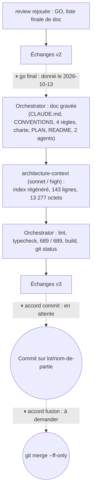

# Lot `nom-de-partie` — graphe d'échanges

> Documentation de ce qui s'est **réellement** passé. Écrit par l'Orchestrator, pas par un
> sous-agent. N'invente rien.

## Version 3 — 2026-10-13, après le go final (avant le commit)

Le commit et la fusion n'ont pas encore eu lieu : chacun attend un accord séparé de
l'utilisateur. La Version 2 ci-dessous reste valable pour tout ce qui précède le go ; seuls
la fin du graphe et les tables changent.

### Graphe (fin du lot)

Boucles : toujours **3 tours sur 5**.

### Ce qui change dans les tables

**Skills** : `refresh-architecture` **n'a pas été invoquée** ; son brief
(`.claude/agents/architecture-context.md`, lu sur disque) a été passé directement à l'agent
`architecture-context`.

**Sous-agents** : ajouter `architecture-context` — sonnet / high (frontmatter), 1 lancement,
régénération de l'index après la gravure de `CLAUDE.md` ; 8 constats reportés, #2 recoté
Basse (confirmé par l'Orchestrator).

**Règles** : `persistence.md`, `testing.md`, `frontend-react.md` et `glossary.md` sont désormais
**modifiées** par le lot (et non plus « à compléter »).

**Commandes shell** (Orchestrator) : `Get-ChildItem` des ports driving et des hooks (recompte de
`CONVENTIONS` § 14) ; `npm run lint`, `npm run typecheck`, `npm test` (689), `npm run build`,
`git status --short` avant commit ; mesure de l'index (`Measure-Object`, `Get-Item`) et
`git grep` de `Math.random` / `window.` / `navigator.` dans `src/core`.

## Version 2 — 2026-10-12, après le tour 3 (avant le go final)

La gravure de la documentation, la régénération de l'index, le commit et la fusion n'ont pas
encore eu lieu.

### Légende

- Trait plein : phase exécutée, rapport écrit.
- Trait pointillé : confirmation utilisateur, gate, ou boucle de retour.

### Graphe

```mermaid
flowchart TD
  U([Utilisateur : /orchestrate nom-de-partie high]) --> O[Orchestrator]
  O --> I[Intake validé : request.md copié octet pour octet]
  I --> CTX[Index : à jour, pas de régénération]
  CTX --> B[Branche lot/nom-de-partie depuis main 6145677]
  B --> AA["archi-authority (opus / max) : PASS<br/>scout et designer sautés : surface gravée"]
  AA --> G1{Gate Archi}
  G1 -.->|"⏸ confirmation utilisateur"| D1["dev : 650 / 650"]
  D1 --> T1["test : P1-P5 problèmes de test"]
  T1 -.->|"T4 + correction : utilisateur"| D2["tour 1 · dev : tests seuls, 686"]
  D2 --> T2["test rejoué : P1-P5 levés"]
  T2 --> S1["sec : constat politique"]
  S1 -.->|"tour 2 · boucle 2 (auto)"| D3["dev : politique + __proto__, 688"]
  D3 --> T3["test rejoué"] --> S2["sec rejoué : levé"]
  S2 --> R1["review (opus / max) : GO"]
  R1 --> E1[Échanges v1]
  E1 -.->|"⏸ go final : amendement nuit,<br/>constats 3-4, D2 signé"| D4["tour 3 · boucle 5 · dev : nuit au jour du calendrier + tests, 689"]
  D4 --> T4["test rejoué : N1 levé, R1-R4"]
  T4 -.->|"R1, R2 laissés : utilisateur"| S3["sec rejoué : aucun constat"]
  S3 --> R2["review rejouée : GO, liste finale de doc"]
  R2 --> E2[Échanges v2]
  E2 -.->|"⏸ go final : en attente"| FIN((En attente))
```

Boucles : **3 tours sur 5** — tour 1 (Test → Dev, problèmes de test, demande utilisateur) ;
tour 2 (Sécurité → Dev, boucle 2, bug d'implémentation : politique) ; tour 3 (Revue → Dev,
boucle 5 : amendement utilisateur de la nuit + constats de revue 3 et 4). Aucun retour vers
Archi ; la Révision 1 d'`01-architecture.md` consigne l'amendement sans relancer la chaîne
(classement confirmé par la Revue).

### Agents, skills, règles et commandes utilisés

> Relevé vérifié dans la session (appels `Skill`, `Agent` et `subagent_type`, shell).

**Skills** (`.claude/skills/`)

| Skill | Déclenchée par | Usage |
|---|---|---|
| `orchestrate` | Utilisateur (`/orchestrate nom-de-partie high`) | Pilotage du lot |

`refresh-architecture` : pas encore appliquée (index à jour au démarrage) ; prévue après la
gravure de `CLAUDE.md`.

**Sous-agents** (`.claude/agents/`)

| Agent | Modèle / effort | Lancements | Pour quoi |
|---|---|---|---|
| `archi-scout` | — | 0 | Sauté : surface gravée annoncée par l'intake |
| `archi-designer` | — | 0 | Sauté : idem |
| `archi-authority` | opus / max (frontmatter) | 1 | Architecture : PASS |
| `dev` | opus (surcharge) / medium | 4 | Implémentation ; tours 1, 2, 3 |
| `test` | opus (surcharge) / high | 4 | Plan de test ; rejeux après tours 1, 2, 3 |
| `sec` | opus (surcharge) / high | 3 | Revue sécurité ; rejeux après tours 2, 3 |
| `review` | opus / max (frontmatter) | 2 | Revue finale ; rejeu après tour 3 |

⚠️ `test`, `sec` et `review` n'ont disposé que de Read / Grep / Glob : les commandes de
vérification ont été lancées par l'Orchestrator.

**Règles** (`.claude/rules/`)

| Règle | Rôle dans le lot |
|---|---|
| `persistence.md` | Appliquée ; à compléter en fin de lot (clé absente, `BACKUP_VERSION`) |
| `testing.md` | Appliquée ; à modifier en fin de lot (fuseau fixé, Q-D2) |
| `frontend-react.md` | Appliquée ; à compléter en fin de lot (`useNomDePartie`, `services.clock`) |
| `theme-colors.md` | Appliquée : tokens seuls, rien sous `craie/60` |
| `typescript.md` | Appliquée : branded `MatchName`, unions exhaustives, `GameModeId` dans les tests |
| `biome.md` | Appliquée : `biome check` vert |
| `response-policy.md` | Appliquée — et prise en défaut une fois : Q6 close comme « évidente » au gate Archi sur un intake contradictoire, tranchée à l'inverse par l'utilisateur (constat de revue 11) |
| `documentation-language.md` | Appliquée |
| `glossary.md` | À compléter en fin de lot |
| `commit.md` | Appliquée : branche du lot, pas de commit sans accord |
| `prospective.md` | Vérifiée : renommage de l'étude seulement à la demande de l'utilisateur |

**Commandes shell** (toutes par l'Orchestrator)

| Commande | Usage |
|---|---|
| `git status`, `git branch`, `git log -1 --format=%ct -- <sources>` | Mise en place, fraîcheur de l'index |
| `git switch -c lot/nom-de-partie`, copie + `Get-FileHash` | Branche, snapshot de l'intake |
| `npm run lint`, `npm run typecheck`, `npm test` (×4) | Après Dev (650), tours 1 (686), 2 (688), 3 (689) |
| `git status --short`, `git diff --stat -- src`, recherche de « veille » | Contrôle de l'arbre après chaque passe de dev |
| `git diff -U0` de `backupSchema.ts` (×2) et de `labels.ts` | Réserve D3 ; politique limitée aux l. 273 et 295 |
| `npm audit`, `npm audit --omit=dev`, `npm audit --json` | S2 : 0 en prod, 8 en dev préexistantes |
| `npm run build` | S2 : build vert |

### Rapports

- [request.md](./request.md) — snapshot validé, non modifié (amendement de la nuit consigné ailleurs)
- [00-orchestration.md](./00-orchestration.md)
- [01-architecture.md](./01-architecture.md) — dont Révision 1
- [02-dev-notes.md](./02-dev-notes.md) — dont tours 1, 2, 3
- [03-plan-de-test.md](./03-plan-de-test.md) — dont rejeux après tours 1, 2, 3
- [04-revue-securite.md](./04-revue-securite.md) — dont rejeux, risque D2 signé
- [05-revue.md](./05-revue.md) — dont rejeu après tour 3 et liste finale de documentation

### Statut final

En attente du go final de l'utilisateur. Revue : GO (3 / 5 tours). Restent avant le commit :
gravure de la documentation (liste finale de `05-revue.md`), `/refresh-architecture`,
contrôles (lint, typecheck, 689 tests, build, `git status`), relecture à l'écran.

---

## Version 1 — 2026-10-12, avant le tour 3 (historique)
### Légende

- Trait plein : phase exécutée, rapport écrit.
- Trait pointillé : confirmation utilisateur, gate, ou boucle de retour.

### Graphe

```mermaid
flowchart TD
  U([Utilisateur : /orchestrate nom-de-partie high]) --> O[Orchestrator]
  O --> I[Intake validé : request.md copié octet pour octet]
  I --> CTX[Index .ai/architecture-context.md : à jour, pas de régénération]
  CTX --> B[Branche lot/nom-de-partie depuis main 6145677]
  B --> AA["archi-authority (opus / max) : PASS<br/>scout et designer sautés : surface gravée"]
  AA --> G1{Gate Archi}
  G1 -.->|"⏸ confirmation utilisateur : oui"| D1["dev (opus) : 650 / 650"]
  D1 --> G2{Gate Dev}
  G2 --> T1["test (opus) : aucun bug, P1-P5 problèmes de test<br/>commandes lancées par l'Orchestrator"]
  T1 -.->|"questions T4 et correction des tests : utilisateur"| G3{Gate Test}
  G3 -.->|"tour 1 : Test → Dev"| D2["dev (opus) : tests seuls, 686 / 686"]
  D2 --> T2["test (opus) rejoué : P1-P5 levés, N1 / N2 assumés"]
  T2 --> S1["sec (opus) : constat n° 1 (politique)<br/>S2 : diff, audit, build par l'Orchestrator"]
  S1 -.->|"tour 2 : Sécurité → Dev (auto)"| D3["dev (opus) : politique + test __proto__, 688 / 688"]
  D3 --> T3["test (opus) rejoué : aucun constat"]
  T3 --> S2["sec (opus) rejoué : constat levé"]
  S2 --> G4{Gate Sécurité}
  G4 --> R["review (opus / max) : GO, aucune boucle"]
  R --> E[Échanges : ce fichier]
  E -.->|"⏸ go final utilisateur : en attente"| FIN((En attente))
```

Boucles : 2 tours sur 5 (tour 1 : Test → Dev, problèmes de test, à la demande de
l'utilisateur ; tour 2 : Sécurité → Dev, bug d'implémentation). Aucun retour vers Archi.

### Agents, skills, règles et commandes utilisés

> Relevé vérifié dans la session (appels `Skill`, `Agent` et `subagent_type`, shell).

**Skills** (`.claude/skills/`)

| Skill | Déclenchée par | Usage |
|---|---|---|
| `orchestrate` | Utilisateur (`/orchestrate nom-de-partie high`) | Pilotage du lot |

`refresh-architecture` : non invoquée (index jugé à jour au démarrage). Elle sera appliquée en
fin de lot, après la gravure de `CLAUDE.md`.

**Sous-agents** (`.claude/agents/`)

| Agent | Modèle / effort | Lancements | Pour quoi |
|---|---|---|---|
| `archi-scout` | — | 0 | Sauté : surface gravée annoncée par l'intake |
| `archi-designer` | — | 0 | Sauté : idem |
| `archi-authority` | opus / max (frontmatter) | 1 | Architecture : PASS |
| `dev` | opus (surcharge) / medium | 3 | Implémentation ; tour 1 (tests) ; tour 2 (politique + test `__proto__`) |
| `test` | opus (surcharge) / high | 3 | Plan de test ; rejeu après tour 1 ; rejeu après tour 2 |
| `sec` | opus (surcharge) / high | 2 | Revue sécurité ; rejeu après tour 2 |
| `review` | opus / max (frontmatter) | 1 | Revue finale : GO |

⚠️ `test`, `sec` et `review` n'ont disposé que de Read / Grep / Glob dans cette session : les
commandes de vérification ont été lancées par l'Orchestrator.

**Règles** (`.claude/rules/`)

| Règle | Rôle dans le lot |
|---|---|
| `persistence.md` | Appliquée : champ ajouté sans renommage, `backupSchema` dans le même lot, pas de migration, `localStorage` non utilisé |
| `testing.md` | Appliquée (fakes, heure locale, tests qui peuvent échouer) ; à modifier en fin de lot (fuseau fixé, Q-D2) |
| `frontend-react.md` | Appliquée (route par étape, labels, 48 px) ; à compléter en fin de lot (`useNomDePartie`, `services.clock`) |
| `theme-colors.md` | Appliquée : tokens seuls, rien sous `craie/60` |
| `typescript.md` | Appliquée : branded `MatchName`, union exhaustive dans `nameOf` |
| `biome.md` | Appliquée : `biome check` vert |
| `response-policy.md` | Appliquée : aucune règle de jeu improvisée ; Q6 tranchée sur le critère 2 et soumise à confirmation |
| `documentation-language.md` | Appliquée : fichiers du lot en français |
| `glossary.md` | À compléter en fin de lot (« nom de partie ») |
| `commit.md` | Appliquée : branche du lot, pas de commit sans accord |
| `prospective.md` | Vérifiée : renommage de l'étude en `PARTIAL` seulement si l'utilisateur le demande |

**Commandes shell** (toutes par l'Orchestrator)

| Commande | Usage |
|---|---|
| `git status`, `git branch`, `git log -1 --format=%ct -- <sources>` | Mise en place, fraîcheur de l'index |
| `git switch -c lot/nom-de-partie`, copie + `Get-FileHash` | Branche, snapshot de l'intake |
| `npm run lint`, `npm run typecheck`, `npm test` (×3) | Après Dev (650), après tour 1 (686), après tour 2 (688) |
| `git status --short`, `git diff --stat -- src` | Contrôle de l'arbre après chaque passe de dev |
| `git diff -U0 -- src/core/application/use-cases/backupSchema.ts` (×2) | Réserve D3 de sec ; absence de trace de contre-épreuve |
| `git diff -U0 -- src/ui/labels.ts` | Seules les lignes 273 et 295 changent dans la politique |
| `npm audit`, `npm audit --omit=dev`, `npm audit --json` | S2 : 0 en prod, 8 en dev préexistantes |
| `npm run build` | S2 : build vert (PWA, precache 48 entrées) |

### Rapports

- [request.md](./request.md)
- [00-orchestration.md](./00-orchestration.md)
- [01-architecture.md](./01-architecture.md)
- [02-dev-notes.md](./02-dev-notes.md)
- [03-plan-de-test.md](./03-plan-de-test.md)
- [04-revue-securite.md](./04-revue-securite.md)
- [05-revue.md](./05-revue.md)

### Statut final

En attente du go final de l'utilisateur. Revue : GO. Restent avant le commit : gravure de la
documentation (liste de `05-revue.md`), régénération de l'index, contrôles, acceptations (T1,
D5, D2, N1 / N2, Q6) et relecture à l'écran.
