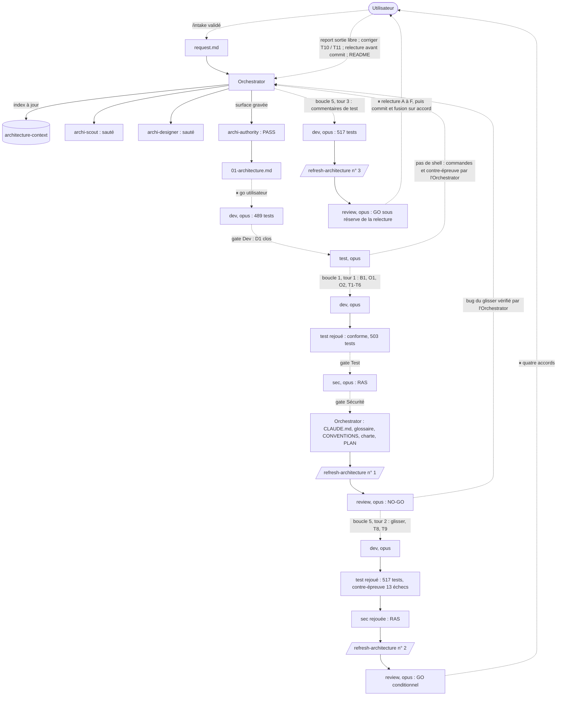

# Lot `nouvelle-partie-en-etapes` — graphe d'échanges

> Documentation de ce qui s'est **réellement** passé. Écrit par l'Orchestrator, pas par un
> sous-agent. N'invente rien.

## Version 2 (2026-10-11) — après la Revue v3

### Légende

- Trait plein : phase exécutée, rapport écrit.
- Trait pointillé : confirmation utilisateur, gate, ou boucle de retour.

### Graphe

### Rapports

- [00-orchestration.md](./00-orchestration.md) — journal, tours de boucle (3 / 5 au total)
- [request.md](./request.md) — demande validée par l'intake
- [01-architecture.md](./01-architecture.md) — `archi-authority`, PASS ; annotations en § Révisions
- [02-dev-notes.md](./02-dev-notes.md) — implémentation et trois tours de correction
- [03-plan-de-test.md](./03-plan-de-test.md) — stratégie, plan de relecture à l'écran, deux rejeux
- [04-revue-securite.md](./04-revue-securite.md) — RAS, puis rejeu RAS
- [05-revue.md](./05-revue.md) — v1 NO-GO, v2 GO conditionnel, v3 GO

### Statut final

**Terminé** : GO de la Revue v3 ; relecture A à F faite par l'utilisateur, qui a donné son
accord au commit sur `lot/nouvelle-partie-en-etapes` et à la fusion dans `main` (2026-10-12).
Relecture G (Android) et H (iPhone) après le commit.

---

## Version 1 (2026-10-11) — après la Revue v2 (historique)

Graphe arrêté à « review : GO conditionnel → ⏸ accords utilisateur avant commit » ; tours de
boucle 2 / 5. Remplacé par la version 2 ci-dessus, qui le prolonge.
