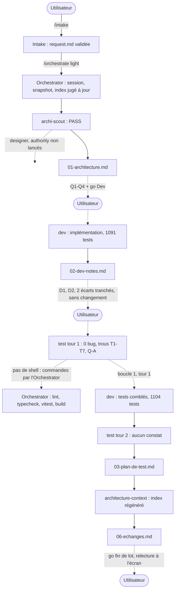

# Lot `nouvelle-partie-parcours` — graphe d'échanges

> Documentation de ce qui s'est **réellement** passé. Écrit par l'Orchestrator, pas par un
> sous-agent. N'invente rien.

Lot mené **en parallèle** (worktree `C:\Users\kevin\Documents\Flechettes-nouvelle-partie-parcours`,
port 5202) de `statistiques-podium` (`..\Flechettes-statistiques-podium`). Aucun rebase à ce
stade : `main` n'a pas bougé depuis `6109013` au moment d'écrire ; les conflits attendus
(`labels.ts`, charte, CONVENTIONS, étude, index) se traiteront à la fusion du second lot.

## Légende

- Trait plein : phase exécutée, rapport écrit.
- Trait pointillé : confirmation utilisateur, gate, ou boucle de retour.

## Graphe

Sécurité et Revue : **hors niveau** (`light`).

## Agents, skills, règles et commandes utilisés

> Relevé vérifié dans la session (appels `Skill`, `Agent` et `subagent_type`, shell).

**Skills** (`.claude/skills/`)

| Skill | Déclenchée par | Usage |
|---|---|---|
| `intake` | Utilisateur (`/intake nouvelle-partie-parcours`) | Cadrage, `docs/request/nouvelle-partie-parcours.md` |
| `orchestrate` | Utilisateur (`/orchestrate nouvelle-partie-parcours light`) | Pilotage du lot |

`refresh-architecture` **non invoquée** : son brief (agent `architecture-context`, lu sur
disque) a été appliqué directement par l'Orchestrator.

**Sous-agents** (`.claude/agents/`)

| Agent | Modèle / effort | Lancements | Pour quoi |
|---|---|---|---|
| `archi-scout` | sonnet / low | 1 | Architecture (PASS, retenu) |
| `archi-designer` | — | 0 | Non lancé : scout en PASS |
| `archi-authority` | — | 0 | Non lancé : scout en PASS, aucune surface gravée |
| `dev` | sonnet / medium | 2 | Implémentation ; boucle 1 (trous de test, Q-A) |
| `test` | sonnet / high | 2 | Tour 1 et tour 2 (lecture statique, sans shell) |
| `architecture-context` | sonnet / high | 1 | Régénération de `.ai/architecture-context.md` |
| `sec`, `review` | — | 0 | Hors niveau (`light`) |

**Règles** (`.claude/rules/`)

| Règle | Rôle dans le lot |
|---|---|
| `frontend-react.md` | Appliquée : une route par étape, `labels.ts`, 48 px, « manche » |
| `theme-colors.md` | Appliquée : laiton unique, paires de rôle, aucun `/NN` sur le texte |
| `testing.md` | Appliquée : fakes, rôles, tests d'absence qui peuvent échouer (contre-épreuves) |
| `typescript.md` | Appliquée : port driving typé, branded `PlayerId` |
| `biome.md` | Appliquée : `biome check --write src tests` seul |
| `glossary.md` | Appliquée : « manche », « premier à N », jamais « best of » |
| `prospective.md` | Appliquée : l'étude n'a pas gravé, c'est le lot qui met `CLAUDE.md` à jour |
| `persistence.md` | Vérifiée sans objet : aucun format persisté ; `partie:joueurs` reste une préférence |
| `documentation-language.md` | Appliquée : docs du lot en français |
| `response-policy.md` | Appliquée : questions produit posées, jamais tranchées par un agent |
| `commit.md` | À appliquer : accord avant commit, branche du lot |

**Commandes shell**

| Commande | Lancée par | Usage |
|---|---|---|
| `git status`, `git log`, `git worktree list`, `git branch --show-current` | Orchestrator | Mise en place, fraîcheur de l'index |
| `npm run lint`, `npm run typecheck`, `npx vitest run`, `npm run build` | Dev (2 fois), Orchestrator (2 fois) | Vérifications ; l'agent `test` n'en avait pas |
| `npx biome check --write src tests` | Dev | Format |
| Mutations temporaires de `src/` puis restauration | Dev (boucle 1) | Contre-épreuves T1-T7 |
| `vite preview --port 5202` + Chrome | Dev | 56 captures (`docs/maquettes/nouvelle-partie-parcours/`) |
| `git diff -- src/ui/composants/commun/Pictogramme.tsx` | Orchestrator | Recoupe le seul changement source de la boucle |

## Rapports

- [request.md](./request.md)
- [00-orchestration.md](./00-orchestration.md)
- [01-architecture.md](./01-architecture.md)
- [02-dev-notes.md](./02-dev-notes.md)
- [03-plan-de-test.md](./03-plan-de-test.md)
- `04-revue-securite.md`, `05-revue.md` : hors niveau

## Index régénéré

`.ai/architecture-context.md` (12e passe) : 149 lignes, 13 289 octets (plafond 160 / 13 312).
15 constats reportés (#19 réduit), aucun retiré, 2 nouveaux : **#25** (moyenne) — « Les règles en
entier » rédige des règles dans l'UI (`labels.ts:925-964`), à valider par le lot 11 ; **#26**
(basse) — `CONVENTIONS.md` § 14 annonce « 21 ports driving » sans `ShuffleOrder`
(`CONVENTIONS.md:358,382-389`). Limite signalée par l'index : un lot `light` qui ajoute une puce à
`CLAUDE.md` § Décisions structurantes (voir § Statut final).

## Statut final

Terminé (Architecture, Dev, Test faits ; 1 tour de boucle sur 5). **Go de l'utilisateur** donné
après relecture à l'écran ; niveau `light` maintenu malgré la puce ajoutée à `CLAUDE.md` ;
constat #26 de l'index laissé en dette. Commit et fusion sur accord.
