# Lot `pave-unifie` — graphe d'échanges

> Documentation de ce qui s'est **réellement** passé. Écrit par l'Orchestrator, pas par un
> sous-agent. N'invente rien.

## Légende

- Trait plein : phase exécutée, rapport écrit.
- Trait pointillé : confirmation utilisateur, gate, ou boucle de retour.

## Graphe

```mermaid
flowchart TD
  P["Planche 6b « Pavé unifié »<br/>artifact privé, relue en entier"] -.->|choix utilisateur : placement b,<br/>laiton unique, Cricket comme la planche| I["/intake pave-unifie<br/>docs/request/pave-unifie.md validé"]
  I -.->|/orchestrate pave-unifie light* refusé,<br/>relancé en light| O[Orchestrator]
  O --> B["Branche lot/pave-unifie<br/>depuis main 9620984"]
  B --> C["Index à jour → non régénéré"]
  C --> S1["archi-scout : PASS"]
  S1 --> A["01-architecture.md<br/>+ §§ 10-16 Conformité à la planche (Orchestrator)"]
  A -.->|arrêt Archi → Dev| U1{{"Utilisateur : « oui vas y pour le dev »"}}
  U1 --> D1["dev #1 : 4 étapes, un seul passage<br/>975 tests, 24 captures, mesures Chrome"]
  D1 --> G1["Orchestrator : lint, typecheck, vitest,<br/>build, encodage → verts ; 02-dev-notes.md"]
  G1 --> T1["test #1 : PASS<br/>N5 (contraste), N3 (couverture), N1, N2"]
  T1 -.->|boucle 1, tour 1| D2["dev (repris par message) :<br/>2 rangs en laiton-clair, tests → 979"]
  D2 --> G2["Orchestrator : contrôles verts ;<br/>Q1-Q4 closes (03)"]
  G2 --> T2["test #2 : PASS<br/>T2-1, T2-2 closes par l'Orchestrator"]
  T2 --> R["architecture-context : index régénéré<br/>(charte modifiée) ; #22, #23 corrigés à la source"]
  R --> E["06-echanges.md"]
  E -.->|arrêt de fin de lot| F{{"Go utilisateur,<br/>relecture à l'écran"}}
```

Chaque passage du Dev a été suivi de la relance par l'Orchestrator de lint, typecheck,
`npx vitest run`, build, et d'un Grep d'encodage, tous verts. Un tour de boucle sur cinq.

## Constats hors lot consignés

- **Petit texte en `text-laiton` en thème clair (#21 de l'index, Moyenne)** : liens « Retour… »
  des écrans de partie et des résumés, Accueil (`AccueilEcran.tsx:169,177`), `Panneau`,
  `Statistiques`… ≈ 3,5:1 sur `feutre` clair d'après le Test, sous le plancher de 4,5:1.
  **Préexistant sur `main`** (le diff du lot n'ajoute que cinq `text-laiton`, tous traités).
  Correctif probable : `text-laiton-clair` pour le petit texte. À un lot dédié.
- **N1** : `appuiBoundary` ne voit que les couleurs de texte posées sur une `.touche`, pas les
  fonds ni toutes les teintes. Dette.

## Agents, skills, règles et commandes utilisés

> Relevé vérifié dans la session. La planche, l'intake et la phase Architecture ont eu lieu avant
> un résumé de contexte : ces lignes sont « d'après le résumé et le journal ».

**Skills** (`.claude/skills/`)

| Skill | Déclenchée par | Usage |
|---|---|---|
| `intake` | Utilisateur (`/intake pave-unifie`) | Cadrage, écriture de `docs/request/pave-unifie.md` (d'après le résumé) |
| `orchestrate` | Utilisateur (`/orchestrate pave-unifie light`) | Pilotage du lot |

`refresh-architecture` **n'a pas été invoquée** : son brief, lu sur disque, a été passé
directement à l'agent `architecture-context`.

**Sous-agents** (`.claude/agents/`)

| Agent | Modèle / effort | Lancements | Pour quoi |
|---|---|---|---|
| `archi-scout` | sonnet / low | 1 | Architecture (d'après le journal) |
| `archi-designer` | sonnet / high | 0 | Non lancé : scout en PASS |
| `archi-authority` | opus / max | 0 | Non lancé : aucune surface gravée |
| `dev` | sonnet / medium (maxTurns 100) | 1 (+1 reprise par message) | Lot ; boucle 1 |
| `test` | sonnet / high | 2 | Tentatives 1 et 2 (PASS) |
| `architecture-context` | sonnet / high | 1 | Index régénéré avant commit |
| `sec`, `review` | — | 0 | Hors niveau (`light`) |

**Règles** (`.claude/rules/`)

| Règle | Rôle dans le lot |
|---|---|
| `theme-colors.md` | Appliquée : laiton unique, tokens seulement, plancher 4,5:1 (boucle 1) |
| `frontend-react.md` | Appliquée : pavé dans `commun/`, libellés dans `labels.ts`, 48 px, paysage |
| `testing.md` | Appliquée : fakes, fléchettes reçues, gardes qui peuvent échouer (contre-épreuves) |
| `biome.md` | Appliquée : `lint:fix` limité à `src tests` |
| `commit.md` | Appliquée : branche du lot, aucun commit avant accord |
| `response-policy.md` | Appliquée : aucune règle de jeu touchée ; Cricket à plus de six cibles non inventé |
| `prospective.md` | Appliquée : l'étude ne reçoit que les choix de l'utilisateur |
| `documentation-language.md` | Appliquée : charte, CONVENTIONS et fichiers du lot en français |
| `persistence.md` | Vérifiée sans objet : aucun format persisté, `Dart.label` intact |

**Commandes shell**

| Commande | Lancée par | Usage |
|---|---|---|
| `git switch -c lot/pave-unifie`, `git status`, `git log -1 --format=%ct` | Orchestrator | Branche, fraîcheur de l'index (d'après le journal) |
| `git show main:src/index.css`, `git diff main -- src/ui`, `git grep` | Orchestrator | Anciennes valeurs d'accent, emplois de `text-laiton` ajoutés vs préexistants |
| `npm run lint`, `npm run typecheck`, `npx vitest run`, `npm run build` | Orchestrator (×2) et Dev | 975 puis 979 tests |
| `npx biome check --write src tests` | Dev | Format |
| `playwright-core` (`scratchpad/pave-script/mesures.mjs`) | Dev | Mesures Chrome et 24 captures `scratchpad/pave-unifie/` |
| `Get-Content` / `Get-Item` | Orchestrator, `architecture-context` | Mesure de l'index (148 lignes, 13 000 octets) |

## Rapports

- [request.md](./request.md)
- [00-orchestration.md](./00-orchestration.md)
- [01-architecture.md](./01-architecture.md) (§§ 10-16 ajoutés à l'arrêt Archi → Dev)
- [02-dev-notes.md](./02-dev-notes.md)
- [03-plan-de-test.md](./03-plan-de-test.md) (tentatives 2 puis 1)
- `04-revue-securite.md`, `05-revue.md` : hors niveau

## Statut final

**Terminé.** Phases du niveau `light` faites (Test PASS, tentative 2). Go de l'utilisateur à
l'arrêt de fin de lot (« ok continue ») pour le commit et la fusion. Relecture à l'écran non
notée : Accueil, choix du jeu, quatre résumés, Bulle armée en Double, thème clair.
