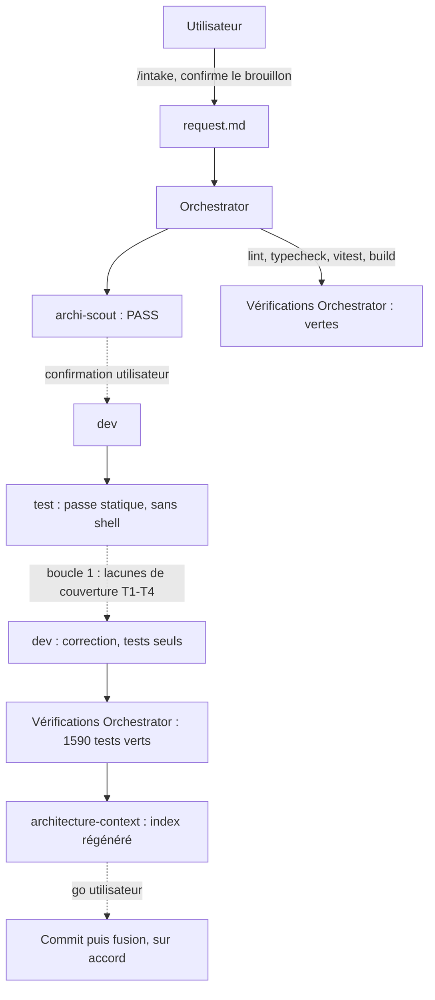

# Lot `phrases-victoire` — graphe d'échanges

> Documentation de ce qui s'est **réellement** passé. Écrit par l'Orchestrator, pas par un
> sous-agent. N'invente rien.

## Légende

- Trait plein : phase exécutée, rapport écrit.
- Trait pointillé : confirmation utilisateur, gate, ou boucle de retour.

## Graphe

`archi-designer` et `archi-authority` : non lancés (scout en PASS). `sec` et `review` : hors
niveau (`light`).

## Agents, skills, règles et commandes utilisés

> Relevé vérifié dans la session (appels `Skill`, `Agent` et `subagent_type`, shell).

**Skills** (`.claude/skills/`)

| Skill | Déclenchée par | Usage |
|---|---|---|
| `intake` | Utilisateur (`/intake phrases-victoire`) | Cadrage, écriture de `docs/request/phrases-victoire.md` |
| `orchestrate` | Utilisateur (`/orchestrate phrases-victoire light`) | Pilotage du lot |

Le brief `architecture-context` a été appliqué en lançant directement l'agent du même nom, sans
invoquer la skill `refresh-architecture`.

**Sous-agents** (`.claude/agents/`)

| Agent | Modèle / effort | Lancements | Pour quoi |
|---|---|---|---|
| `archi-scout` | sonnet / low | 1 | Architecture (PASS) |
| `archi-designer` | — | 0 | Scout en PASS |
| `archi-authority` | — | 0 | Scout en PASS, aucune surface gravée |
| `dev` | sonnet / medium | 2 | Implémentation ; correction de tests (boucle 1) |
| `test` | sonnet / high | 1 | Relecture statique (aucun outil d'exécution) |
| `sec`, `review` | — | 0 | Hors niveau (`light`) |
| `architecture-context` | sonnet / high | 1 | Régénération de l'index |

Modèle et effort : ceux du frontmatter de `.claude/agents/` (aucun `model` surchargé à l'appel).

**Règles** (`.claude/rules/`)

| Règle | Rôle dans le lot (*modifiée*, *appliquée* ou *vérifiée sans objet*) |
|---|---|
| `commit.md` | Appliquée : branche `lot/phrases-victoire`, accord avant commit |
| `glossary.md` | Appliquée : « manche », « checkout » ; vocabulaire inchangé |
| `documentation-language.md` | Appliquée : docs du lot en français |
| `testing.md` | Appliquée : fakes, `renderWithServices`, `gestes.ts` |
| `frontend-react.md` | Appliquée : français dans `labels.ts`, UI → use cases |
| `persistence.md` | Vérifiée sans objet : aucun format persisté |
| `theme-colors.md`, `biome.md`, `typescript.md` | Vérifiées sans objet / appliquées par lint et typecheck |

**Commandes shell**

| Commande | Lancée par | Usage |
|---|---|---|
| `git status`, `git diff --stat`, `git log`, `Get-FileHash` | Orchestrator | État de l'arbre, fraîcheur de l'index, copie octet pour octet de la demande |
| `npm run lint`, `npm run typecheck`, `npx vitest run` | Dev (rapports) puis Orchestrator (relancées) | Vérifications du lot ; 1585 puis 1590 tests |
| `npm run build` | Orchestrator | Build vert |

## Rapports

- [00-orchestration.md](./00-orchestration.md)
- [01-architecture.md](./01-architecture.md)
- [02-dev-notes.md](./02-dev-notes.md)
- [03-plan-de-test.md](./03-plan-de-test.md)
- [04-revue-securite.md](./04-revue-securite.md) (hors niveau)
- [05-revue.md](./05-revue.md) (hors niveau)

## Statut final

Terminé côté code et tests (1590 verts), en attente du go utilisateur, du commit et de la fusion.
Reste hors lot : écoute de la voix sur un vrai téléphone.
