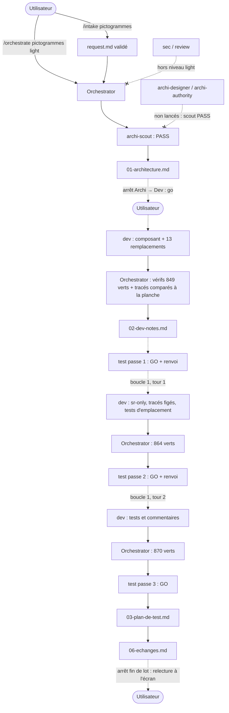

# Lot `pictogrammes` — graphe d'échanges

> Documentation de ce qui s'est **réellement** passé. Écrit par l'Orchestrator, pas par un
> sous-agent. N'invente rien.

## Origine

Lot 4 du découpage de l'étude `docs/prospective/2026-10-13-NEW-revision-charte-graphique.md`.
Cadré par `/intake pictogrammes` : deux questions (périmètre, minimum 20 px), puis relecture contre
la planche validée à la demande de l'utilisateur (40 px à l'étape 1, victoire en laiton, nul en
craie). La géométrie de la planche, qui ne vit que dans un dossier temporaire, a été recopiée dans
la demande.

## Légende

- Trait plein : phase exécutée, rapport écrit.
- Trait pointillé : confirmation utilisateur, gate, ou boucle de retour.

## Graphe

## Agents, skills, règles et commandes utilisés

> Relevé vérifié dans la session (appels `Skill`, `Agent` et `subagent_type`, shell).

**Skills** (`.claude/skills/`)

| Skill | Déclenchée par | Usage |
|---|---|---|
| `intake` | Utilisateur (`/intake pictogrammes`) | Cadrage, `docs/request/pictogrammes.md` |
| `orchestrate` | Utilisateur (`/orchestrate pictogrammes light`) | Pilotage du lot |

`refresh-architecture` non nécessaire : index jugé à jour selon la règle de fraîcheur.

**Sous-agents** (`.claude/agents/`)

| Agent | Modèle / effort | Lancements | Pour quoi |
|---|---|---|---|
| `archi-scout` | sonnet / low (frontmatter) | 1 | Architecture → PASS |
| `archi-designer` | — | 0 | Non nécessaire : scout en PASS |
| `archi-authority` | — | 0 | Non nécessaire : aucune surface gravée |
| `dev` | sonnet / medium, maxTurns 100 (frontmatter) | 3 | Implémentation ; boucle 1 tours 1 et 2 |
| `test` | sonnet / high (frontmatter) | 3 | Passes 1, 2, 3 — sans shell les trois fois |
| `sec`, `review` | — | 0 | Hors niveau `light` |

**Règles** (`.claude/rules/`)

| Règle | Rôle dans le lot |
|---|---|
| `frontend-react.md` | Appliquée : icônes `aria-hidden`, tout le français dans `labels.ts` (`LIBELLE_VAINQUEUR`) |
| `theme-colors.md` | Appliquée : `currentColor` seul, aucune exception de couleur |
| `typescript.md` | Appliquée : `as const`, type dérivé, `Record` exhaustif, taille en union fermée |
| `testing.md` | Appliquée : fakes, contre-épreuves, test qui fige les tracés, garde à plancher |
| `biome.md` | Appliquée : `lint:fix` limité à `src tests` |
| `persistence.md` | Vérifiée sans objet |
| `commit.md` | Appliquée : branche `lot/pictogrammes`, accord avant commit |

**Commandes shell**

| Commande | Lancée par | Usage |
|---|---|---|
| `git log -1 --format=%ct`, `git status`, `git switch -c lot/pictogrammes` | Orchestrator | Fraîcheur de l'index, préconditions, branche |
| Copie de `request.md` + comparaison d'empreintes | Orchestrator | Snapshot octet pour octet |
| Script `node` (fichier temporaire hors dépôt) recalculant la planche | Orchestrator | Comparaison des tracés du composant à la planche |
| `node -e` (calcul seul), `npx biome check --write src tests`, `npm run lint`, `npm run typecheck`, `npx vitest run`, `npm run build`, contre-épreuves | Dev (trois passes) | Tracés et vérifications |
| `git status`, `git diff --stat`, grep des imports `lucide` remplacés, relecture UTF-8, `npm run lint`, `npm run typecheck`, `npx vitest run`, `npm run build` | Orchestrator | Vérification après chaque passe Dev (849, 864, 870 verts) |

## Rapports

- [request.md](./request.md)
- [00-orchestration.md](./00-orchestration.md)
- [01-architecture.md](./01-architecture.md)
- [02-dev-notes.md](./02-dev-notes.md)
- [03-plan-de-test.md](./03-plan-de-test.md)
- `04-revue-securite.md`, `05-revue.md` : hors niveau `light`, gabarits non remplis

## Statut final

Terminé (Test GO, 870 tests verts, build OK, 2 tours de boucle sur 5). Go de l'utilisateur pour le
commit et la fusion le 2026-10-14 ; aucune relecture à l'écran notée avant le commit.
