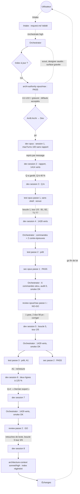

# Lot `reglages-par-usage` — graphe d'échanges

> Documentation de ce qui s'est **réellement** passé. Écrit par l'Orchestrator, pas par un
> sous-agent. N'invente rien.

**Lot en parallèle** (`orchestrate` § Lots en parallèle) : worktree
`C:\Users\kevin\Documents\Flechettes-reglages-par-usage`, port 5201, mené en même temps que
`rejouer` (`..\Flechettes-rejouer`, port 5202). `rejouer` a fusionné d'abord (`63cb636`) :
**rebase** sur `main` avec l'accord de l'utilisateur (TO1). Conflits : `.claude/CONVENTIONS.md`
(clés de requête, compte et arbre des ports → 25 driving), `docs/CHARTE_GRAPHIQUE.md` (sections
Rejouer et Réglages), `docs/PROJECT_PLAN.md` (§ 0, § 4, § 6) — les deux apports gardés ;
`.ai/architecture-context.md` repris de `main` puis régénéré. Fusionnés sans conflit : `labels.ts`,
`container.ts`, `clesRequetes.ts`, `CLAUDE.md`, `theme-colors.md`. Après rebase : lint, typecheck,
build, smoke OK ; **1496 / 1497** — l'échec (`parcours.test.tsx`, délai de 5 s dépassé en suite
complète) existe aussi sur `main` seul (1407 / 1408) et passe isolé : préexistant, pas du lot.

## Légende

- Trait plein : phase exécutée, rapport écrit.
- Trait pointillé : confirmation utilisateur, gate, ou boucle de retour.

## Graphe

## Agents, skills, règles et commandes utilisés

> Relevé vérifié dans la session (appels `Skill`, `Agent` et `subagent_type`, shell).

**Skills** (`.claude/skills/`)

| Skill | Déclenchée par | Usage |
|---|---|---|
| `intake` | Utilisateur (`/intake reglages-par-usage`) | Cadrage, `docs/request/reglages-par-usage.md` |
| `orchestrate` | Utilisateur (`/orchestrate reglages-par-usage high`) | Pilotage du lot |

`refresh-architecture` n'a **pas** été invoquée : son brief (`.claude/agents/architecture-context.md`,
lu sur disque) a été appliqué en lançant directement l'agent `architecture-context`.

**Sous-agents** (`.claude/agents/`)

| Agent | Modèle / effort | Lancements | Pour quoi |
|---|---|---|---|
| `archi-scout` | — | 0 | Sauté : surface gravée annoncée par l'intake |
| `archi-designer` | — | 0 | Sauté : même raison |
| `archi-authority` | opus / max | 1 | Architecture (PASS) |
| `dev` | opus / medium (maxTurns 100) | 1 lancement, repris 7 fois par message (sessions 2 à 8) | Code, tests, docs, captures ; boucles 1 et 5 ; Q-b ; Q-d ; mesures 360 px |
| `test` | opus / high | 3 (passes 1, 2, 3) | Plan de test, couverture, contre-épreuves raisonnées |
| `sec` | opus / high | 2 (passes 1, 2) | Revue sécurité (PASS) |
| `review` | opus / max | 2 (passes 1, 2) | NO-GO puis GO |
| `architecture-context` | sonnet / high | 1 | Régénération de `.ai/architecture-context.md` |

**Règles** (`.claude/rules/`)

| Règle | Rôle dans le lot |
|---|---|
| `theme-colors.md` | *Modifiée* : trois familles de jetons réservés (`vert-etat`, `apercu-*`) ; appliquée |
| `persistence.md` | *Appliquée* : `localStorage` réservé aux préférences d'appareil ; format persisté inchangé |
| `frontend-react.md` | *Appliquée* : `labels.ts`, `services.clock`, 48 px, `<output aria-label>`, relecture écran |
| `testing.md` | *Appliquée* : fakes, changements d'heure avec précondition, contre-épreuves |
| `typescript.md`, `biome.md` | *Appliquées* : `lint:fix` limité à `src tests` |
| `glossary.md`, `documentation-language.md` | *Appliquées* : docs en français |
| `prospective.md` | *Appliquée* : l'étude n'est annotée qu'au titre du lot |
| `response-policy.md` | *Appliquée* : points produit non tranchés renvoyés à l'utilisateur |
| `commit.md` | *Appliquée* : accord avant commit, branche du lot (commit non fait à ce stade) |

**Commandes shell**

| Commande | Lancée par | Usage |
|---|---|---|
| `npm run lint`, `npm run typecheck`, `npx vitest run`, `npm run build` | Dev (chaque session), puis Orchestrator (4 fois) | Vérifications ; 1414 → 1428 → 1429 verts |
| `npx biome check --write src tests` | Dev | Format limité aux chemins du lot |
| `npm run smoke` | Orchestrator (3 fois) | Aucune requête externe, aucun `REMPLIR` |
| `npm audit --omit=dev` | Orchestrator | 0 vulnérabilité, lot et `main` |
| Contre-épreuves (mutation, test ciblé, restauration vérifiée par empreinte) | Orchestrator (2), Dev (plusieurs) | Tests capables d'échouer |
| `git status` (chemins sensibles), recherches réseau / clé | Orchestrator | Commandes 1-3 de la Sécurité |
| `vite preview --port 5201` + Chrome (`playwright-core`, `shoot.cjs`) | Dev | Captures et mesures, `C:\Users\kevin\Documents\Flechettes\docs\maquettes\reglages-par-usage\` |
| `git worktree list`, `git branch --show-current`, `git log` (fraîcheur de l'index) | Orchestrator | Mise en place |

## Rapports

- [request.md](./request.md)
- [00-orchestration.md](./00-orchestration.md)
- [01-architecture.md](./01-architecture.md)
- [02-dev-notes.md](./02-dev-notes.md)
- [03-plan-de-test.md](./03-plan-de-test.md)
- [04-revue-securite.md](./04-revue-securite.md)
- [05-revue.md](./05-revue.md)

## Statut final

**Terminé côté pipeline** : Revue GO (passe 2), Sécurité PASS, 1429 tests verts, 3 tours de boucle
sur 5. En attente : go utilisateur de fin de lot, relecture sur appareil, commit puis fusion
(sur accord).
