# Lot `regles-du-jeu` — graphe d'échanges

> Documentation de ce qui s'est **réellement** passé. Écrit par l'Orchestrator, pas par un
> sous-agent. N'invente rien.

## Légende

- Trait plein : phase exécutée, rapport écrit.
- Trait pointillé : confirmation utilisateur, gate, ou boucle de retour.

## Graphe

```mermaid
flowchart TD
  I[Intake : /intake regles-du-jeu<br/>DartsOn consulté, planche regles-rubriques validée] -.->|confirmation id + chemin| O[Orchestrator<br/>/orchestrate regles-du-jeu high]
  O -->|surface gravée : scout et designer sautés| AA1[archi-authority — PASS]
  AA1 -.->|Q1-Q10 tranchées, go| D1[dev — 100 tours atteints, sans rapport]
  D1 -.->|repris : finir| D1b[dev — rapport, 1158 tests]
  D1b -.->|DV1-DV4 tranchées| D1c[dev — DV1, DV4]
  D1c --> T1[test passe 1 — statique ; Orchestrator : commandes + 6 contre-épreuves]
  T1 -.->|boucle 1, tour 1 : C1-C5, C10 ; C6 tranché| D1d[dev — 1172 tests]
  D1d --> T2[Orchestrator : passe 2, 3 contre-épreuves]
  T2 --> S1[sec passe 1 — PASS]
  S1 -.->|question confidentialité tranchée| R1[review passe 1 — NO-GO]
  R1 -.->|converger, rebaser, C9, appareil à la relecture| RB[Orchestrator : commit wip + rebase sur main 26a39fb<br/>conflits de docs : les deux apports gardés]
  RB -.->|boucle 7, tour 2| AA2[archi-authority Révision 1 — PASS]
  AA2 -.->|U1 voile ferme, U2 se rouvre, go| D2[dev neuf — Révision 1, 1329 tests]
  D2 --> T3[Orchestrator : 10 contre-épreuves ; test passe 3 — bug P3-1]
  T3 -.->|boucle 1, tour 3 ; P3-7 tranché| D2b[dev repris — 1340 tests]
  D2b --> T4[Orchestrator : passe 4, 2 contre-épreuves]
  T4 --> S2[sec passe 2 — PASS]
  S2 --> R2[review passe 2 — GO conditionné aux docs]
  R2 -.->|README corrigé| DOC[Orchestrator : PROJECT_PLAN, notes, étude, Échanges]
  DOC --> AC[architecture-context — index régénéré]
  AC -.->|go final, relecture à l'écran| FIN[Commit --amend + fusion --ff-only, sur accord]
```

Boucles : **3 tours sur 5** (Test → Dev ×2 : tours 1 et 3 ; Revue → Archi ×1 : tour 2). Aucun
blocage escaladé.

**Lot en parallèle** : mené dans le worktree `C:\Users\kevin\Documents\Flechettes-regles-du-jeu`
pendant que `statistiques-podium` tournait dans le sien (port 5201 pour lui, 5203 réservé ici).
`statistiques-podium` a été fusionné dans `main` (`26a39fb`) avant la fin de ce lot. Rebase,
avec accord, via un commit temporaire `wip` (`18c9e69` → `9dff1a4`). Conflits :
`.claude/CONVENTIONS.md` (§ 9, § 14), `.claude/rules/frontend-react.md`, `docs/PROJECT_PLAN.md`
(§ 4, § 6) — les deux apports gardés, doublons marqués puis fusionnés par la Révision 1 ; un
conflit de code silencieux (`LIBELLE_FERMER` déclaré deux fois, typecheck rouge) résolu par la
convergence. Le recouvrement de fond (`Modale` + `useModaleAuRetour` contre `useFeuilleRegles`)
n'a été vu qu'à la Revue : c'est la limite du mode parallèle quand deux lots inventent le même
patron.

## Agents, skills, règles et commandes utilisés

> Relevé vérifié dans la session (appels `Skill`, `Agent` et `subagent_type`, shell).

**Skills** (`.claude/skills/`)

| Skill | Déclenchée par | Usage |
|---|---|---|
| `intake` | Utilisateur (`/intake regles-du-jeu`) | Cadrage, demande `docs/request/regles-du-jeu.md` |
| `orchestrate` | Utilisateur (`/orchestrate regles-du-jeu high`) | Pilotage du lot |
| `artifact-design` | Orchestrator (pendant l'intake) | Planche `regles-rubriques.html` publiée et validée |

`refresh-architecture` n'a **pas** été invoquée : son brief (`.claude/agents/architecture-context.md`,
lu sur disque) a été passé à l'agent `architecture-context` lancé directement. Pendant l'intake,
`WebFetch` a lu cinq pages de `dartson.app/rules/` (plan repris, texte non recopié).

**Sous-agents** (`.claude/agents/`)

| Agent | Modèle / effort | Lancements | Pour quoi |
|---|---|---|---|
| `archi-scout` | sonnet / low | 0 | Sauté : surface gravée annoncée par l'intake |
| `archi-designer` | sonnet / high | 0 | Sauté : surface gravée |
| `archi-authority` | opus / max | 2 | Architecture ; Révision 1 (convergence) |
| `dev` | **opus** (forcé) / medium | 2 lancements + 4 reprises | 1er agent : implémentation (arrêt à 100 tours, repris pour finir), DV1 / DV4, boucle 1 tour 1 ; 2e agent : Révision 1, boucle 1 tour 3 |
| `test` | **opus** (forcé) / high | 2 | Passes 1 et 3 (statiques : pas de shell) |
| `sec` | **opus** (forcé) / high | 2 | Passes 1 et 2 (sans shell) |
| `review` | opus / max | 2 | Passe 1 NO-GO, passe 2 GO |
| `architecture-context` | sonnet / high | 1 | Régénération de l'index |

**Règles** (`.claude/rules/`)

| Règle | Rôle dans le lot |
|---|---|
| `response-policy.md` | Appliquée : aucune règle de jeu improvisée ; textes non dessinés écrits d'après `CLAUDE.md` et le code, relus par l'utilisateur ; règles « façon DartsOn » renvoyées à une étude |
| `prospective.md` | Appliquée : les changements de règles DartsOn non cadrés ici ; l'étude existante mise à jour en fin de lot |
| `documentation-language.md` | Appliquée |
| `glossary.md` | **Modifiée** (sortie / pas de finish, feuille de règles) |
| `frontend-react.md` | **Modifiée** (hooks `useModaleAuRetour` + `useDialogueNatif`, règles affichées) |
| `theme-colors.md` | **Modifiée** (« Jetons réservés : la feuille de règles ») |
| `testing.md` | Appliquée : contre-épreuves, `it.each(GAME_MODE_IDS)`, absences qui peuvent échouer |
| `typescript.md`, `biome.md` | Appliquées (`biome check --write src tests`, jamais tout le dépôt) |
| `persistence.md` | Vérifiée sans objet : aucun format persisté touché |
| `commit.md` | Appliquée : commit `wip` et rebase sur accord ; commit final et fusion sur accord |

**Commandes shell**

| Commande | Lancée par | Usage |
|---|---|---|
| `npx biome check --write src tests`, `npm run lint`, `npm run typecheck`, `npx vitest run`, `npm run build` | Dev (chaque session), Orchestrator (après chaque phase, faute de shell chez Test / Sec / Revue) | Vérifications |
| Script de contre-épreuves (`scratchpad\mutations.ps1`) : 21 mutations, restauration octet pour octet, `git diff` comparé | Orchestrator | Tests qui doivent pouvoir échouer |
| `npm run smoke` | Dev (1er build) | Aucun « REMPLIR » |
| `vite preview --port 5203` + captures | Dev (sessions 1-3) | 72 captures et mesures du bandeau (`docs/maquettes/regles/captures-dev/`) |
| `git diff --stat` (fichiers sensibles, `src/core`), `git diff -U0 labels.ts`, `npm audit` | Orchestrator | Vérifications de la Sécurité |
| `git add` (chemins explicites), `git commit` (`wip`), `git rebase main` | Orchestrator, sur accord | Intégration de `main` |

## Rapports

- [request.md](./request.md)
- [00-orchestration.md](./00-orchestration.md)
- [01-architecture.md](./01-architecture.md)
- [02-dev-notes.md](./02-dev-notes.md)
- [03-plan-de-test.md](./03-plan-de-test.md)
- [04-revue-securite.md](./04-revue-securite.md)
- [05-revue.md](./05-revue.md)

## Statut final

GO de la Revue (passe 2), docs gravées, index régénéré. **En attente** du go de l'utilisateur,
puis du commit (`--amend` du `wip`) et de la fusion `--ff-only`, tous deux sur accord. Relecture à
l'écran et vérifications sur appareil acceptées après le lot (PROJECT_PLAN § 0).
