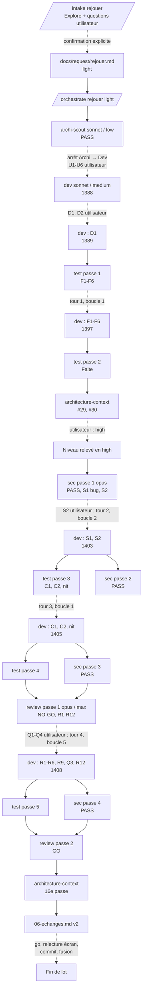

# Lot `rejouer` — graphe d'échanges

> Documentation de ce qui s'est **réellement** passé. Écrit par l'Orchestrator, pas par un
> sous-agent. N'invente rien.

**Version 2** (2026-10-17) — régénérée après le relèvement en `high`, la Sécurité, la Revue et
quatre tours de boucle. La version 1 (fin du niveau `light`, avant relèvement) est résumée en
§ Historique.

Lot mené **en parallèle** (worktree `C:\Users\kevin\Documents\Flechettes-rejouer`, port 5202)
avec le lot `reglages-par-usage` (worktree `Flechettes-reglages-par-usage`). Aucun rebase à ce
stade : les conflits attendus (`labels.ts`, charte, `CLAUDE.md`, CONVENTIONS, PLAN, glossaire,
index `.ai`) se régleront à la fusion du second lot (`orchestrate` § Lots en parallèle, point 6).

## Légende

- Trait plein : phase exécutée, rapport écrit.
- Trait pointillé : confirmation utilisateur, gate, ou boucle de retour.

## Graphe

Tours de boucle : **4 / 5** (boucle 1 × 2, boucle 2 × 1, boucle 5 × 1).

## Agents, skills, règles et commandes utilisés

> Relevé vérifié dans la session (appels `Skill`, `Agent` et `subagent_type`, shell).

**Skills** (`.claude/skills/`)

| Skill | Déclenchée par | Usage |
|---|---|---|
| `intake` | Utilisateur (`/intake rejouer`) | Cadrage, `docs/request/rejouer.md` |
| `orchestrate` | Utilisateur (`/orchestrate rejouer light`) | Pilotage du lot |

`refresh-architecture` n'a pas été invoquée : le brief de l'agent `architecture-context` a été
appliqué directement, deux fois.

**Sous-agents** (`.claude/agents/`)

| Agent | Modèle / effort | Lancements | Pour quoi |
|---|---|---|---|
| `Explore` | défaut | 1 | Intake : lecture du code |
| `archi-scout` | sonnet / low | 1 | Architecture → PASS |
| `archi-designer`, `archi-authority` | — | 0 | Scout PASS ; Architecture non rejouée au relèvement en `high` (décision acceptée par l'utilisateur, Q4) |
| `dev` | sonnet / medium | 1 lancement + 5 reprises | Implémentation ; D1 ; tours 1 à 4 |
| `test` | sonnet / high | 5 | Passes 1 à 5 |
| `sec` | **opus** | 4 | Passes 1 à 4 (montée en gamme) |
| `review` | opus / max | 2 | Passe 1 NO-GO, passe 2 GO |
| `architecture-context` | sonnet / high | 2 | Index régénéré (15e et 16e passes) |

**Règles** (`.claude/rules/`)

| Règle | Rôle dans le lot |
|---|---|
| `frontend-react.md` | Appliquée : UI → use cases, une route par étape, `services.clock`, 48 px, `aria-label`, libellés dans `labels.ts` |
| `theme-colors.md` | Appliquée : jetons seuls, laiton unique |
| `testing.md` | Appliquée : fakes, horloge fake, précondition 23 h / 25 h (R6), tests qui doivent pouvoir échouer (contre-épreuves du Dev). Écart assumé : `GAME_MODE_IDS` non utilisé (N1) |
| `typescript.md` | Appliquée : union discriminée `ReplayableConfiguration`, cœur en anglais (R1) |
| `biome.md` | Appliquée : lint vert, aucun `lint:fix` global |
| `glossary.md` | **Modifiée** : ligne « Rejouer » |
| `persistence.md` | Vérifiée sans objet : aucun format persisté, aucune clé nouvelle ; le trou de `backupSchema` reste hors lot |
| `documentation-language.md` | Appliquée |
| `response-policy.md` | Appliquée : aucun point produit tranché sans l'utilisateur, sauf C1 (application de S2, documenté) |
| `commit.md` | À appliquer : accord avant commit, branche `lot/rejouer` |

**Commandes shell**

| Commande | Lancée par | Usage |
|---|---|---|
| `git branch --show-current`, `git worktree list`, `git status`, `git log -1 --format=%ct` | Orchestrator | Mise en place, fraîcheur de l'index |
| `Copy-Item`, `Get-FileHash` | Orchestrator | Snapshot octet pour octet de la demande |
| `npm run lint`, `npm run typecheck`, `npx vitest run`, `npm run build` | Dev (à chaque tour, annoncé) ; Orchestrator (5 fois, vérifié : 1389, 1397, 1403, 1405, 1408) | `test`, `sec`, `review` n'avaient pas d'outil d'exécution |
| `git checkout --` sur 9 tests | Dev | Ramener des tests existants à l'état du dépôt après D1 |
| Mutations temporaires puis restauration | Dev | Contre-épreuves F1, S1, R6, R9 |
| `git diff --stat -- src/core`, `git diff --stat main -- package.json …`, `Select-String` | Orchestrator | Absence de résidu, fichiers sensibles hors diff |
| `git log -S doubleIn` | Orchestrator | `doubleIn` présent depuis le lot 1 (`8469f55`) |

## Rapports

- [request.md](./request.md)
- [00-orchestration.md](./00-orchestration.md)
- [01-architecture.md](./01-architecture.md)
- [02-dev-notes.md](./02-dev-notes.md)
- [03-plan-de-test.md](./03-plan-de-test.md)
- [04-revue-securite.md](./04-revue-securite.md)
- [05-revue.md](./05-revue.md)

## Historique

- **Version 1** (2026-10-17) : fin du niveau `light` (Architecture, Dev, Test faits, 1397 tests),
  Sécurité et Revue hors niveau ; remplacée après le relèvement en `high` demandé par
  l'utilisateur (constat #30 de l'index).

## Statut final

Toutes les phases du niveau `high` sont **terminées** : Revue **GO**. Restent : go utilisateur,
**relecture à l'écran** (360 px, paysage, sombre et clair, « Solo », pastilles à 4 joueurs,
▶ désactivé) ou report accepté par écrit, commit sur `lot/rejouer`, puis fusion `--ff-only`
depuis le dépôt principal. Suites proposées : lot `high` pour `backupSchema` et les journaux
importés non projetables (Q5), et dette N1 (5e mode).
