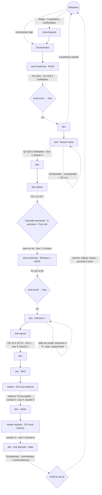

# Lot `statistiques-podium` — graphe d'échanges

> Documentation de ce qui s'est **réellement** passé. Écrit par l'Orchestrator, pas par un
> sous-agent. N'invente rien.

Lot mené **en parallèle** de `nouvelle-partie-parcours` (worktree
`C:\Users\kevin\Documents\Flechettes-statistiques-podium`, port 5201 ; l'autre lot : port 5202).
`nouvelle-partie-parcours` a été fusionné dans `main` (`5644892`) pendant ce lot : **rebase à
faire** avant la fusion (conflits attendus : `labels.ts`, charte, CONVENTIONS, PROJECT_PLAN,
étude, index), avec accord.

**Rebase fait le 2026-10-16** (accord de l'utilisateur) sur `5644892` : conflits dans
`docs/CHARTE_GRAPHIQUE.md` (section du parcours de `main` + écarts U4 / Q3 du lot), `docs/PROJECT_PLAN.md`
(§ 4 et § 6 : les deux lots) et `tests/ui/pictogrammesEmplacements.test.tsx` (tests des tuiles de
`main` + test des cartes du podium) — **les deux apports gardés** partout. `labels.ts` fusionné
sans conflit ; la politique de `main` était au 12 octobre, celle du lot au 16 : **16 gardé** (T9),
phrase relue contre le tableau T8 de `04`. T18 : pas de seconde modale sur `main`. Après rebase :
lint (286 fichiers), typecheck, **71 fichiers, 1233 tests**, build verts ; Grep d'encodage propre.
Index `.ai/architecture-context.md` régénéré (agent `architecture-context`, brief lu sur disque :
148 lignes, 13 268 octets), constat #27 (coquille introduite par l'Orchestrator dans PLAN § 0)
corrigé puis retiré. Commit amendé.

## Légende

- Trait plein : phase exécutée, rapport écrit.
- Trait pointillé : confirmation utilisateur, gate, ou boucle de retour.

## Graphe

Statut : phases terminées, **5 tours de boucle sur 5** (plafond atteint, sans escalade). Commit,
rebase et fusion en attente d'accord.

## Agents, skills, règles et commandes utilisés

**Skills** (`.claude/skills/`)

| Skill | Déclenchée par | Usage |
|---|---|---|
| `intake` | Utilisateur (`/intake statistiques-podium`) | Cadrage, `docs/request/statistiques-podium.md` |
| `orchestrate` | Utilisateur (`/orchestrate statistiques-podium high`) | Pilotage du lot |

`refresh-architecture` : non invoquée ; son brief (`architecture-context`) appliqué directement après le rebase.

**Sous-agents** (`.claude/agents/`)

| Agent | Modèle / effort | Lancements | Pour quoi |
|---|---|---|---|
| `archi-scout` | — | 0 | Sauté : surface gravée annoncée par l'intake |
| `archi-designer` | — | 0 | Idem |
| `archi-authority` | opus / max | 2 | Architecture initiale ; Révision 1 |
| `dev` | opus (forcé) / medium | 1 lancement, **repris 8 fois par message** | Implémentation, gate Dev, tours 1, 3, 4, 5, Révision 1 et ses précisions |
| `test` | opus (forcé) / high | 3 | Plan initial ; rejeu boucle 1 ; rejeu Révision 1 (lecture seule, sans shell) |
| `sec` | opus (forcé) / high | 1 | Revue sécurité (sans shell) |
| `review` | opus / max | 2 | Revue finale ; revue rejouée sur le tour 4 |
| `architecture-context` | sonnet / high | 1 | Régénération de l'index après le rebase |

**Règles** (`.claude/rules/`)

| Règle | Rôle dans le lot |
|---|---|
| `frontend-react.md` | *Modifiée* (hook `useModaleAuRetour`) ; appliquée |
| `theme-colors.md` | Appliquée (tokens pleins, bâtons sans alpha, écart U4 consigné) |
| `testing.md` | Appliquée (fakes, contre-épreuves, tests d'absence avec témoin) |
| `persistence.md` | Appliquée (préférence d'appareil seulement) ; vérifiée sans objet pour Dexie / `backupSchema` |
| `glossary.md`, `documentation-language.md` | Appliquées (« manche », docs en français) |
| `biome.md`, `typescript.md` | Appliquées (`lint:fix` sur `src tests`, `biome-ignore` justifiés) |
| `response-policy.md` | Appliquée (points produit renvoyés à l'utilisateur) |
| `prospective.md` | Appliquée (étude mise à jour par le lot) |
| `commit.md` | À appliquer (accord avant commit, branche du lot) |

**Commandes shell**

| Commande | Lancée par | Usage |
|---|---|---|
| `git branch`, `git status`, `git log`, `git diff --stat HEAD`, `git worktree list`, `git merge-base` | Orchestrator | Mise en place, fraîcheur de l'index, surfaces inchangées, `main` qui a bougé |
| `npm run lint`, `npm run typecheck`, `npx vitest run`, `npm run build` | Dev, puis Orchestrator après chaque tour | Vérifications (1116 → 1118 → 1136 → 1176 → 1180 → 1187 → 1193 → 1194 tests) |
| Contre-épreuves (copie, mutation, `npx vitest run …`, restauration, SHA-256) | Orchestrator (a-e, CE-1 à CE-7, CE-16 à CE-22, constat 11) ; Dev (CE-1 à CE-15 de la Révision 1, T-M1, tours 3-5) | Prouver que les tests peuvent échouer |
| `npm audit --omit=dev` | Orchestrator | 0 vulnérabilité |
| Vite sur le port 5201 + Chrome (`playwright-core`) | Dev | Relecture à l'écran et captures (scratchpad) |

Outil `Artifact` (lecture) : l'Orchestrator a lu l'artifact de la planche pour clore U0.

## Rapports

- [request.md](./request.md) (snapshot) et [`docs/request/statistiques-podium.md`](../../request/statistiques-podium.md) (Révision 1)
- [00-orchestration.md](./00-orchestration.md)
- [01-architecture.md](./01-architecture.md)
- [02-dev-notes.md](./02-dev-notes.md)
- [03-plan-de-test.md](./03-plan-de-test.md)
- [04-revue-securite.md](./04-revue-securite.md)
- [05-revue.md](./05-revue.md)

## Statut final

Terminé côté phases : **GO** (constat 11 fermé au tour 5 ; T19 et Q3 de `sec` acceptées après le
lot par l'utilisateur). Commit, rebase et régénération de l'index faits. Reste, avec accord : fusion `--ff-only` dans
`main` depuis le dépôt principal.
