# Lot `stockage-persistant` — graphe d'échanges

> Ce document retrace ce qui s'est **réellement** passé. Il est écrit par l'Orchestrator, pas
> par un sous-agent, et n'invente rien. La version la plus récente est en tête ; l'historique
> est conservé dessous.

## Légende

- **Trait plein** : la phase a été exécutée et son rapport écrit.
- **Trait pointillé** : confirmation de l'utilisateur, gate, ou boucle de retour.
- Entre crochets : modèle / effort réellement lancés (frontmatter, sans surcharge à l'appel).

## Version 2 — après le tour 3 (décision de l'utilisateur à l'arrêt de fin de lot)

```mermaid
flowchart TD
  U([Utilisateur]) -.->|/intake → request.md validé| O[Orchestrator]
  O -->|index à jour, branche, snapshot request.md| S[archi-scout<br/>sonnet / low<br/>PASS]
  S --> A1[01-architecture.md]
  A1 -.->|⏸ « oui lance Dev »| D1[dev<br/>sonnet / medium]
  D1 --> T1[test<br/>sonnet / high<br/>PASS]
  T1 --> SEC1[sec<br/>sonnet / high<br/>constat 1 : fausse assurance]
  SEC1 -.->|boucle 2, tour 1/5| D2[dev : réserve « pas une sauvegarde »]
  D2 --> T2[test rejoué] --> SEC2[sec rejoué : clos]
  SEC2 --> G[Orchestrator : puce CLAUDE.md<br/>+ architecture-context]
  G --> R1[review<br/>opus / max<br/>NO-GO]
  R1 -.->|boucle 5, tour 2/5| D3[dev : CONVENTIONS § 14, PLAN, type]
  D3 --> P{{en parallèle}}
  P --> RF1[architecture-context] --> OC[Orchestrator : compteur § 14] --> RF2[architecture-context]
  P --> T3[test rejoué]
  RF2 --> SEC3[sec rejoué : RAS]
  T3 --> SEC3
  SEC3 --> R2[review rejouée : GO]
  R2 --> E1[06-echanges v1]
  E1 -.->|⏸ arrêt de fin de lot| U2([Utilisateur :<br/>« Redemander ne fait rien » → option A])
  U2 -.->|boucle 5, tour 3/5 — plafond boucle 5 atteint| D4[dev<br/>sonnet / medium<br/>retour après refus]
  D4 --> OC2[Orchestrator : compteurs PLAN 363 → 366]
  OC2 --> T4[test rejoué<br/>0 bug]
  T4 --> RF3[architecture-context<br/>13 256 o. CRLF]
  RF3 --> SEC4[sec rejoué<br/>RAS]
  SEC4 --> R3[review rejouée<br/>opus / max<br/>GO]
  R3 --> E2[06-echanges v2]
  E2 -.->|⏸ go de fin de lot, puis commit, puis fusion| U3([Utilisateur])
```

### Ce qu'il faut retenir

- **3 tours de boucle sur 5.** La boucle 5 a atteint son plafond (2/2) : toute nouvelle
  modification de code demandée maintenant serait une **escalade**, pas une boucle automatique.
- **Le tour 3 vient de l'utilisateur.** À l'arrêt, il a constaté que « Redemander » semblait ne
  rien faire. Un message apparaît désormais après un refus, et seulement après une action de
  l'utilisateur.
- **Le tour 3 s'est enchaîné en séquence** (Dev → Test → refresh → Sec → Revue). Le
  parallélisme du tour 2 ne s'est pas reproduit.
- **Corrections mécaniques de doc faites par l'Orchestrator** : deux dans le lot (compteur de
  § 14, compteurs de tests). Elles sont acceptées par la Revue, qui en signale la cause au
  n° 19.

## Version 1 — fin des phases (avant l'arrêt de fin de lot)

- Architecture : le scout a suffi.
- **Boucle 2** (Sécurité → Dev) : la réserve « pas une sauvegarde » est ajoutée.
- **Boucle 5, tour 2** (Revue → Dev) : correction de l'arbre de référence (CONVENTIONS § 14).
- **Écarts de processus relevés** :
  - correction d'un compteur par l'Orchestrator ;
  - refresh de l'index et rejeu de Test partis en parallèle ;
  - arrêt Architecture → Dev journalisé après coup.
- Le graphe détaillé de cette étape est repris, tel quel, dans la première moitié de la
  version 2.

## Rapports

- [request.md](./request.md) : la demande validée à l'intake (snapshot)
- [00-orchestration.md](./00-orchestration.md)
- [01-architecture.md](./01-architecture.md)
- [02-dev-notes.md](./02-dev-notes.md) : passage initial, boucle 2, boucle 5 (tours 2 et 3)
- [03-plan-de-test.md](./03-plan-de-test.md) : passage initial et trois rejeux
- [04-revue-securite.md](./04-revue-securite.md) : versions 1 à 4
- [05-revue.md](./05-revue.md) : version 1 (no-go), versions 2 et 3 (go)

## Statut final

**Phases terminées, Revue GO (v3).** Le go de fin de lot reste à l'utilisateur. Il porte sur
la validation des libellés (dont la phrase de refus et le « rappel dans les trois états »), la
relecture à l'écran et la vérification sur appareil. Viennent ensuite le commit sur
`lot/stockage-persistant`, puis la fusion `--ff-only` dans `main`, chacun avec son propre accord.
