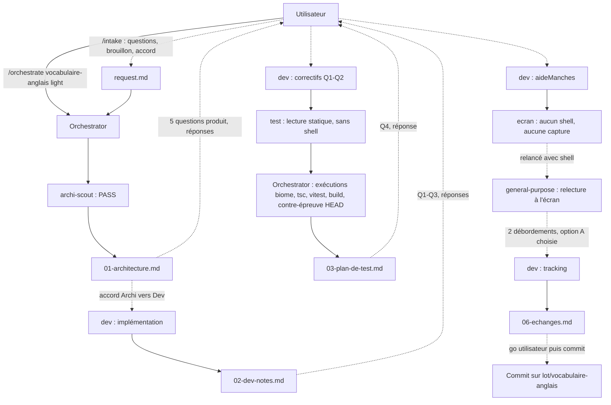

# Lot `vocabulaire-anglais` — graphe d'échanges

> Documentation de ce qui s'est **réellement** passé. Écrit par l'Orchestrator, pas par un
> sous-agent. N'invente rien.

**Lot mené en parallèle** (worktree `C:\Users\kevin\Documents\Flechettes-vocabulaire-anglais`, port de
capture 5201) ; un autre worktree existait au même moment (`lot/annulation-volee`, vu par
`git worktree list`). Aucun rebase ni conflit à ce stade : la fusion n'a pas encore eu lieu.

## Légende

- Trait plein : phase exécutée, rapport écrit.
- Trait pointillé : confirmation utilisateur, gate, ou boucle de retour.

## Graphe

Déroulé réel : intake (brief appliqué par l'Orchestrator, voir plus bas) ; chaîne d'architecture
réduite au scout (`PASS` du premier coup) ; arrêt Archi → Dev, accord de l'utilisateur ; Dev ; deux
tours de questions produit ; Test ; correctif Q4 ; relecture à l'écran en deux temps (l'agent `ecran`
n'a pas de shell) ; correctif des deux débordements par réduction du tracking (option A). Aucune
boucle Test → Dev n'a été déclenchée (aucun bug d'implémentation) ; trois tours de Dev ont répondu à des
décisions produit, pas à des constats de Test.

## Agents, skills, règles et commandes utilisés

**Skills** (`.claude/skills/`)

| Skill | Déclenchée par | Usage |
|---|---|---|
| `orchestrate` | Utilisateur (`/orchestrate vocabulaire-anglais light`) | Pilotage du lot |

`intake` n'a pas été invoquée : elle est réservée à la saisie de l'utilisateur (`/intake`) ; l'Orchestrator
en a appliqué le brief (questions, brouillon, écriture après confirmation explicite de
`docs/request/vocabulaire-anglais.md`).

**Sous-agents** (`.claude/agents/` sauf mention)

| Agent | Modèle / effort | Lancements | Pour quoi |
|---|---|---|---|
| `archi-scout` | sonnet / low | 1 | Architecture (`PASS`) |
| `archi-designer`, `archi-authority` | — | 0 | Chaîne non nécessaire (scout `PASS`) |
| `dev` | sonnet / medium | 4 | Implémentation ; correctifs Q1-Q2 ; correctif Q4 (`aideManches`) ; tracking des deux libellés |
| `test` | sonnet / high | 1 | Adéquation des tests, **lecture statique** (aucun shell) |
| `ecran` | sonnet / medium | 1 | **Aucune capture** (aucun shell) ; rapport non retenu |
| `general-purpose` (hors `.claude/agents/`) | modèle par défaut du harnais, non précisé | 1 | Relecture à l'écran avec le brief d'`ecran`, port 5201 |
| `sec`, `review` | — | 0 | **Hors niveau** (`light`) |

Modèle et effort : d'après les frontmatters des agents ; pour `general-purpose`, le modèle réel n'a pas été
vérifié.

**Règles** (`.claude/rules/`)

| Règle | Rôle dans le lot |
|---|---|
| `glossary.md` | *Modifiée* : « checkout » à l'écran, `en-US` à la voix |
| `documentation-language.md`, `response-policy.md` | *Appliquées* : docs en français, aucune règle de jeu improvisée |
| `commit.md` | *Appliquée* : branche du lot, accord avant commit (non encore demandé) |
| `testing.md`, `typescript.md`, `biome.md`, `frontend-react.md`, `theme-colors.md` | *Appliquées* par le Dev (fakes, branded types, lint, charte) |
| `persistence.md` | *Vérifiée sans objet* : aucun format ni clé persistée touchés |

**Commandes shell**

| Commande | Lancée par | Usage |
|---|---|---|
| `npx biome check src tests`, `npm run typecheck`, `npx vitest run`, `npm run build` | Dev (×4) et Orchestrator | Vérifications du lot |
| `git status`, `git diff --stat -- src/core`, `git ls-files --eol`, vérification BOM / mojibake | Orchestrator | Périmètre, encodage |
| `git worktree add --detach … HEAD`, `vitest run` ×2 sur `HEAD`, retrait du worktree | Orchestrator | Contre-épreuve : `parcours.test.tsx` lent aussi sur `HEAD` |
| `vitest run tests/ui/parcours.test.tsx` ×3 | Orchestrator | Test lent seul : 2 / 2 |
| `vite preview --port 5201`, `playwright-core` + Chrome | `general-purpose` et Dev | Captures et mesures de débordement |

## Constats de relecture à l'écran

- Aucun bloquant. Deux débordements dus au mot plus long, corrigés par le Dev : colonne Volée de
  `LigneJoueur` (65,6 → 49,8 px dans 60 px) et tuile « CHECKOUTS » de `CartePartie` (62,4 → 50,5 px
  dans 56 px, marge 2,3-3,3 px, « un peu juste »). Taille de police inchangée (plancher de la charte).
- Remarques hors lot : « MANCHE1/10 » et « RÉUSSIES0 » sans espace à l'entraînement (non comparé à
  `HEAD`) ; moment « Checkout ! » inatteignable en X01 (non capturé).
- **Pas de nouvelle capture** après le correctif de tracking : seules des mesures DOM l'ont confirmé.

## Reste à faire hors CI

- Écoute sur vrai téléphone (Android, iPhone) : accent `en-US`, `rate = 1.1`, choix de voix par `lang`,
  pause entre énoncés, segment `. À toi, X` éventuellement lu « point », repli français.
- Régénérer `.ai/architecture-context.md` (`/refresh-architecture`) : son inventaire dit encore « deux
  sorties » ; à faire avant le commit selon `orchestrate`, **après accord** (non lancé).
- `PROJECT_PLAN.md` § 6 : entrée du lot non écrite.

## Rapports

- [00-orchestration.md](./00-orchestration.md)
- [request.md](./request.md)
- [01-architecture.md](./01-architecture.md)
- [02-dev-notes.md](./02-dev-notes.md)
- [03-plan-de-test.md](./03-plan-de-test.md)
- 04-revue-securite.md, 05-revue.md : hors niveau (`light`)

## Statut final

Prêt pour le go de l'utilisateur : Architecture, Dev, Test et Échanges **Faites**. Rien n'est commité.
