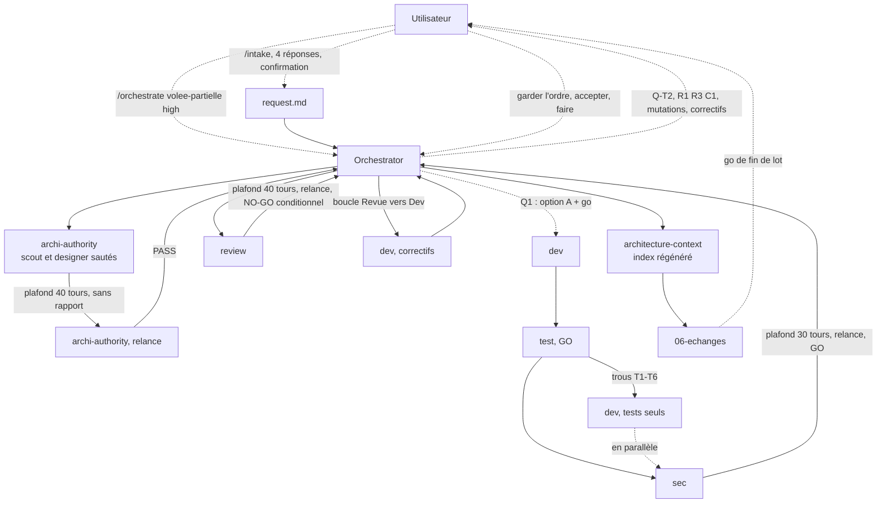

# Lot `volee-partielle` — graphe d'échanges

> Documentation de ce qui s'est **réellement** passé. Écrit par l'Orchestrator, pas par un
> sous-agent. N'invente rien. Le lot a tourné **seul** dans le dépôt principal (pas de worktree, aucun
> autre lot en parallèle) ; il suit les lots B (`hors-statistique`) et E (`phrases-victoire`), déjà fusionnés.

## Légende

- Trait plein : phase exécutée, rapport écrit.
- Trait pointillé : confirmation utilisateur, gate, ou boucle de retour.

## Graphe

## Agents, skills, règles et commandes utilisés

> Relevé vérifié dans la session (appels `Skill`, `Agent` et `subagent_type`, shell).

**Skills** (`.claude/skills/`)

| Skill | Déclenchée par | Usage |
|---|---|---|
| `intake` | Utilisateur (`/intake volee-partielle`) | Cadrage, écriture de `docs/request/volee-partielle.md` |
| `orchestrate` | Utilisateur (`/orchestrate volee-partielle high`) | Pilotage du lot |

`refresh-architecture` n'a pas été invoquée comme skill : le brief de l'agent `architecture-context` a été
appliqué en lançant l'agent directement (`orchestrate` § Prérequis).

**Sous-agents** (`.claude/agents/`)

| Agent | Modèle / effort | Lancements | Pour quoi |
|---|---|---|---|
| `archi-scout` | — | 0 | Sauté : surface gravée (format persisté) |
| `archi-designer` | — | 0 | Sauté : surface gravée |
| `archi-authority` | opus / max (frontmatter) | 1 + 1 relance | Architecture ; plafond de 40 tours atteint sans rapport, rapport rendu à la relance |
| `dev` | opus (surcharge) / medium (frontmatter) | 3 | Implémentation ; comblement des trous de test (`tests/` seuls) ; correctifs de Revue |
| `test` | opus (surcharge) / high | 1 | Plan de test, verdict GO, sans shell |
| `sec` | opus (surcharge) / high | 1 + 1 relance | Revue sécurité ; plafond de 30 tours atteint sans rapport |
| `review` | opus / xhigh | 1 + 1 relance | Revue finale ; plafond de 40 tours atteint sans rapport |
| `architecture-context` | sonnet / medium (passé de high à medium avant le lot) | 1 | Index d'architecture (21e passe), 134 lignes, 13 304 octets |

Les effort sont ceux des frontmatters (l'outil `Agent` ne surcharge que le modèle).

**Règles** (`.claude/rules/`)

| Règle | Rôle dans le lot |
|---|---|
| `persistence.md` | **Modifiée** : `VisitDraftRepository`, `db.version` sans `upgrade` pour une table neuve, le brouillon jamais exporté |
| `frontend-react.md` | **Modifiée** : `useVoleeEnCours`, boîte rouverte après rechargement |
| `glossary.md` | **Modifiée** : ligne « volée en cours (brouillon) » |
| `testing.md` | Appliquée : fakes, jamais de mocks ; `it.each(GAME_MODE_IDS)` ; préconditions des tests d'absence |
| `commit.md` | Appliquée : branche `lot/volee-partielle`, accord avant commit et fusion (pas encore atteints) |
| `documentation-language.md`, `response-policy.md` | Appliquées : français, ce qui n'a pas été vérifié est dit |
| `theme-colors.md`, `typescript.md`, `biome.md` | Vérifiées : aucune couleur ni rendu nouveau ; lint et typecheck propres |

**Commandes shell**

| Commande | Lancée par | Usage |
|---|---|---|
| `git status`, `git switch -c lot/volee-partielle`, `git diff`, `git worktree list` | Orchestrator | Branche du lot, état de l'arbre, snapshot de la demande (SHA-256 identique) |
| `npm run lint`, `npm run typecheck`, `npx vitest run`, `npm run build` | `dev` (3 fois) et Orchestrator (après chaque passage) | Vérifications : 1602 → 1672 → 1685 → **1691 tests verts** |
| `npx biome check --write src tests` | `dev`, Orchestrator | Format |
| Grep `Ã|Â|�` sur `src` et `tests` | Orchestrator | Accents cassés (RAS ; « BÂTONS » légitime) |
| `npm audit --omit=dev`, `npm audit` | Orchestrator | 0 vulnérabilité en production ; 8 de développement antérieures au lot |
| `git diff -- backupSchema.ts` | Orchestrator | `versDart` : seul l'`export` change |
| Mutations manuelles (Edit puis retour) | `dev` (3e lancement) | C2, ordre de Q-T2, effacement avant l'`await` dans trois hooks ; T1-T6 **non faites** (refus de l'auto-mode au 2e lancement, acceptées par l'utilisateur) |

## Incidents du lot

- Trois sous-agents (`archi-authority`, `sec`, `review`) ont atteint leur plafond de tours **sans rendre de
  rapport** ; chacun a été relancé pour livrer ce qu'il avait lu, avec « non vérifié » dit explicitement.
  Signal : ces plafonds sont justes pour un lot qui touche un format persisté.
- Le 2e lancement de `dev` s'est vu refuser par l'auto-mode toute édition temporaire de `src/` et tout lancement de
  commande : les mutations de T1-T6 n'ont pas été faites ; l'Orchestrator n'a pas contourné le refus et l'a
  soumis à l'utilisateur.
- Le hook de formatage a abîmé une fois `voleePartielle.test.tsx` pendant le 3e passage `dev` (fichier
  momentanément invalide) ; réparé par une seconde Edit.
- `01-architecture.md` disait à tort qu'un vieil onglet « échoue » en v3 : corrigé par erratum (vérifié par `sec`).
- La réponse « A » de l'utilisateur (à Q1) a été prise pour le go de l'arrêt Archi → Dev, la question contenant
  « puis-je lancer Dev ? » ; noté dans `00-orchestration.md`.

## Rapports

- [00-orchestration.md](./00-orchestration.md)
- [request.md](./request.md)
- [01-architecture.md](./01-architecture.md)
- [02-dev-notes.md](./02-dev-notes.md)
- [03-plan-de-test.md](./03-plan-de-test.md)
- [04-revue-securite.md](./04-revue-securite.md)
- [05-revue.md](./05-revue.md)

## Statut final

**En attente du go de fin de lot.** Code et documentation prêts ; lint, typecheck, build propres, **1691 tests
verts**. Reste : la **relecture à l'écran sur téléphone** (R2, `history.state` d'iOS, bref spinner, trois
scénarios de la demande), puis le commit et la fusion `--ff-only`, chacun après l'accord de l'utilisateur.
